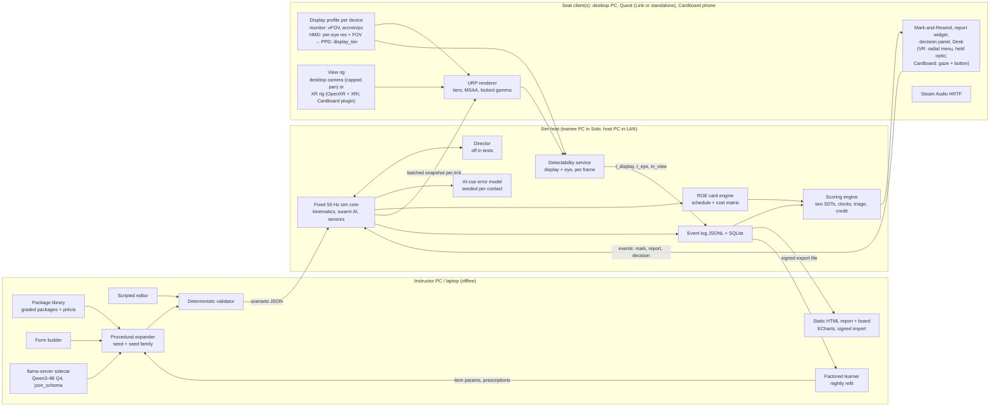
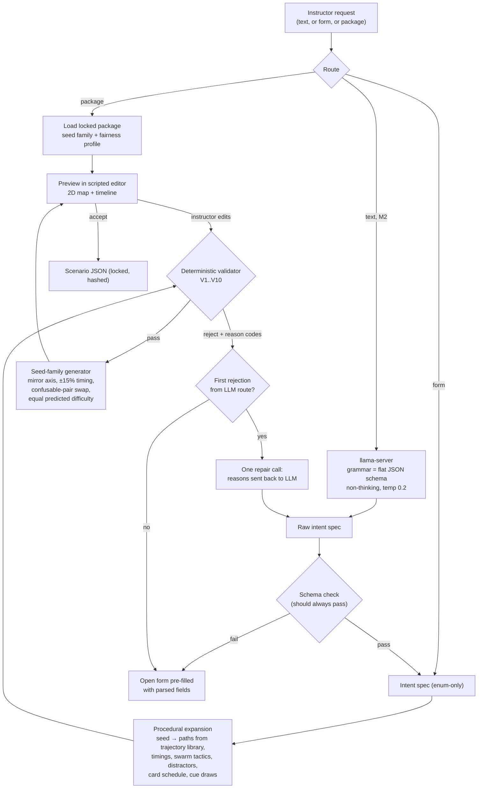
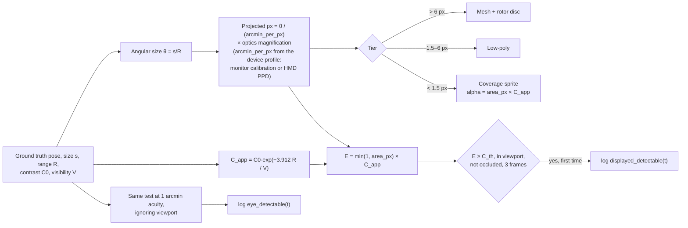
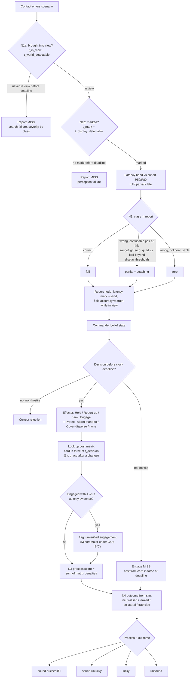
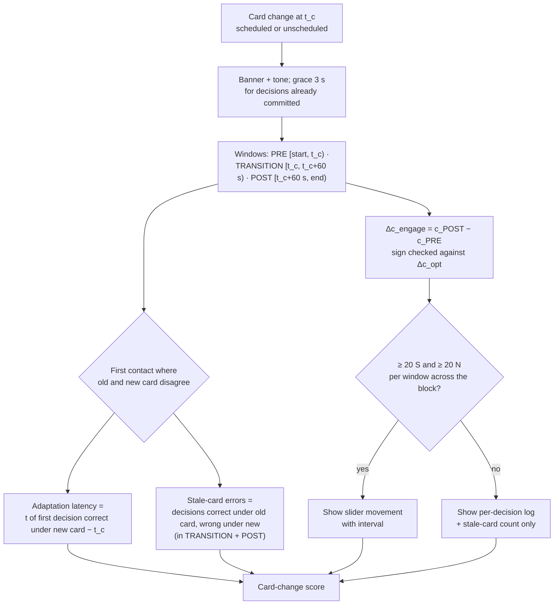
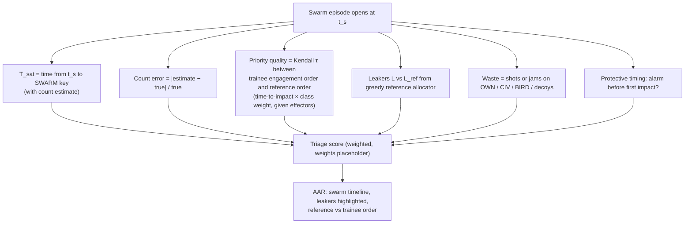
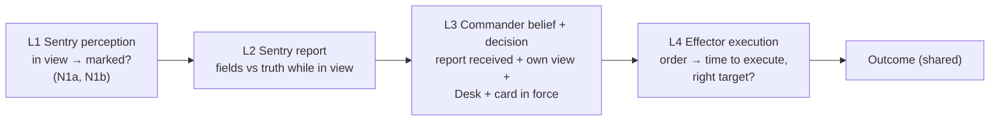
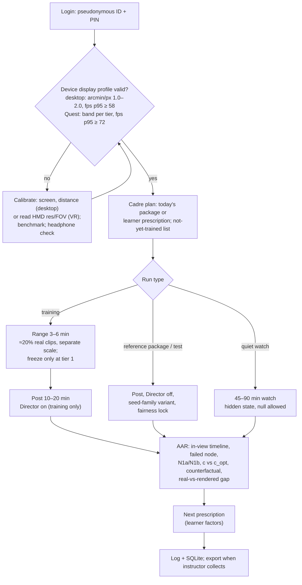

# Solution v2 (after the LLM council): "Chaukanna" C-UAS Threat Simulation Trainer
**PS 26247 · AI-Enabled Drone & Counter-Drone Threat Simulation Trainer (MoD / DSSC)** · 2026-10-06
Inputs: `solution-brief.md` (the base), `council/chairman-verdict.md` (binding), advisors 1–5, peer reviews 1–5, `phase1-research-synthesis.md`, `phase2-options.md`.
Purpose: internal ideation, a prototype and a demo video. This is not a submission, so it optimises for the best design that a 6-person team can build, not for wording that survives judges.

Labels: **[Required by PS]**, **[Optional in PS]**, **[Our addition]**. *[inferred]* means our reasoning, not a source. *[unverified]* means not checked. *[placeholder]* means doctrine or numbers that an officer or a test must replace. Every number marked *[inferred]* is our arithmetic and can be re-derived from the formulas given.

### Working name: "Prahari" is retired
"Prahari" is already the name of a BSF welfare app that the Home Minister launched on 30 Dec 2022 ([GKToday](https://www.gktoday.in/prahari-app-and-bsf-manuals-launched/)). We checked three replacements with a quick web search on 2026-10-06. This was not a trademark search.

| Candidate | Meaning | Clash found in a quick search | Verdict |
|---|---|---|---|
| **Chaukanna** (चौकन्ना) | "alert, on guard", literally "ears pricked" *[common Hindi word]* | None. Two web searches on 2026-10-06 ("Chaukanna" with app / system / army / drone / India) returned no Indian defence system, drone product or government app with this name. This is absence of evidence from a quick search, not a trademark clearance | **Chosen as the working name.** The word says what we train: watchfulness, not firing. Weakness: an everyday word is hard to trademark, which does not matter for an internal prototype. |
| Nabh Netra ("sky eye") | | "Netra" is already the DRDO airborne early-warning system ([DRDO](https://drdo.gov.in/drdo/en/offerings/products/netra), [Wikipedia](https://en.wikipedia.org/wiki/DRDO_Netra)) and an ideaForge UAV ([Gujarat Science City](https://sciencecity.gujarat.gov.in/space/info/idea-forge-netra-6)) | Rejected: two defence products share the root. |
| Nabh Drishti ("sky sight") | | Near-clash with the Adani "Drishti-10" UAV that the Navy operates ([Defense Post](https://www.thedefensepost.com/2024/01/12/india-indigenous-male-drone/)) and with a "Nabh Rakshak" drone ([Drishti IAS](https://www.drishtiias.com/state-pcs-current-affairs/drone-nabh-rakshak-will-save-people-drowning-in-water)) | Rejected: easily confused with drone products. |

### What changed from Version 1, in six lines
1. **Scoring measures what it claims:** a decision clock on every contact, two separate SDT analyses (sentry report and commander engage), passive responses, mid-mission card changes, prevalence as a parameter, swarm triage, and team credit assignment.
2. **The display has an engineering contract:** calibrated 1:1 angular view, angular-size render tiers with a sub-pixel impostor, detectability computed per frame from what was actually displayed, and a fairness lock.
3. **The learner model can run on little data:** a pooled factored logistic model with a minimum-trials gate replaces Elo per cell.
4. **The customer is an Army post, cantonment or airbase with its own Ashni drones overhead.** The Punjab drop becomes a BSF variant.
5. **Honest data:** about 20% real clips on a separate scale, real small pilot data in place of fake history, and a "sim proficiency board" with a training-use-only rule.
6. **The prototype is a solo vertical slice built from a shot list.** The LLM builder (M2) and the 2-seat LAN pair (M3) follow as milestones. Both are locked into the full solution.

**Update 2026-10-06 (user decision): VR is committed, not optional.** The PS only asks for "Desktop or VR-capable", so VR stays **[Optional in PS]**, but it is now **[Our commitment]**: a built feature on the headsets the team owns (Meta Quest and Google Cardboard). Desktop stays the primary unit-level path. What this changes: a **VR sentry seat on Quest** joins the prototype in **M2** (§1.14, §11.1); Cardboard becomes a lightweight Range "spot-and-classify" seat (stretch); the display contract gains **per-device profiles** with separate norms per display tier (§1.7h); new risks K16–K21 (§7). See Appendix A, row V1.

---

## 1. Proposed Solution

### 1.1 The idea in one paragraph
Chaukanna is a Unity desktop trainer, with a committed VR sentry seat (Meta Quest; Cardboard as a light Range seat; §1.14), for the soldier on an Army post, cantonment or airbase perimeter whose sky holds hostile drones, their own unit's Ashni drones, civil drones, birds and manned aircraft ([The Week](https://www.theweek.in/news/defence/2025/12/20/what-are-ashni-platoons-as-indian-army-steps-up-suicide-drone-procurement-after-operation-sindoor.html); [IANS 2026](https://ianslive.in/indian-army-raises-drone-warriors-in-a-year-every-formation-now-has-ashni-platoon--20260505201810)). It trains three links, each scored on its own:
- **Spot it:** search a sector and detect, scored against what the screen actually showed.
- **Name it:** classify through the naked eye, optics, sound and whatever sensor the unit holds.
- **Decide:** choose the response the ROE card in force calls for. The card can change mid-mission.

The trainer runs solo, or as a sentry–commander pair (later a whole post or company) over the unit LAN. Each session follows Range → Post → AAR. The AAR writes the next Range drill. Every procedure is a configurable placeholder until an officer validates it.

**Why this shape, from the evidence:**
- The hard skill is seeing and discriminating, not shooting. Pilots spotted a small quad in 36.8% of intercepts ([Loffi et al. 2016](https://commons.erau.edu/cgi/viewcontent.cgi?article=1142&context=ijaaa)).
- The deadly error is the wrong engagement. Patriot fratricides in 2003 came from automation bias ([CNAS](https://www.cnas.org/publications/reports/patriot-wars)), and both sides in Ukraine have shot down their own drones ([RUSI 2024](https://static.rusi.org/protecting-the-force-from-uncrewed-uas.pdf)).
- Simulation games work as a supplement and when access is repeated (d = 0.51 as a supplement, 0.68 with unlimited access; [Sitzmann 2011](https://www.prisim.com/wp-content/uploads/2017/02/Value-of-Simulation-Training-Univ-of-CO.pdf)).

**What the 3D world is for** (answering advisor 5's clip-drill argument up front): real clips teach appearance better than any render. The 3D world earns its place only on things a clip cannot train:
- search under time pressure across a sector
- shifting the engage threshold when the card changes mid-mission
- swarm triage
- sentry → commander handoffs
- vigilance over a long, quiet watch

The validation pilot (§13) tests exactly these. If the 3D world does not beat an equal-time clip drill on them, we have learned that it is decoration.

### 1.2 Customer, users and seats
The customer is an **Army infantry battalion post, a cantonment, or an airbase perimeter with the unit's own Ashni drones up** (chairman change 18; adv-1; PR-1). The Punjab night drop is a **BSF variant package** for later, because the BSF handles that threat on the Punjab border ([AIR News](https://www.newsonair.gov.in/bsf-seizes-272-drones-over-367-kg-heroin-along-punjab-border-in-2025)).

| Seat | Who *[placeholder roles]* | What they do | Scored on | Phase |
|---|---|---|---|---|
| **Sentry / observer** | Jawan on post | Searches, detects, marks, classifies, **reports**. Does not hold the ROE card: works to orders for sentries (detect, alert, report) (PR-1) | **Report SDT** (signal = any contact), N1a/N1b, N2, report latency and accuracy | M1 (solo, desktop) / **M2 (VR on Quest)** / M3 (seat; desktop or VR) |
| **Post commander** | NCO | Receives reports, checks the Desk panel and optics, and makes the **engage and protect** decision under the card in force. **Stays on desktop**: the Desk panel, card and decision panel are screen work, and a commander does not search the sky *[inferred]* | **Engage SDT** (signal = hostile), c-shift, decision process, swarm triage | M1 (solo) / M3 (seat) |
| Sensor operator | Detachment member | Works the Desk panel (acoustic bearing, RF detector, radar if held) and cues the sentry | Cue latency, cue accuracy | Later (sector mode) |
| Effector crew | AD gun / small arms / EW detachment | **Own low-angle FPV search sector** plus a lead/track task while the commander decides, so the seat is never idle (adv-3) | Tracking error, own-sector N1, execution time | Later |
| Company commander | Officer | Sector mode: all posts' reports, own-drone deconfliction, effector allocation across posts | Deconfliction, allocation | Later |
| Instructor | JCO / officer | Runs **graded packages** (the default), or builds tests by script, procedure, form or LLM; leads the AAR | — | M1 / M2 |
| CO | Unit commander | Reads the **sim proficiency board**: locked reference packages only, training use only | — | M1 (simple) |

In **Solo**, one trainee holds both the sentry and commander seats. They make the report and the engage decision in turn and get **two separate scores**.

### 1.3 Play modes
| Mode | What it is | Scored? | Label | Phase |
|---|---|---|---|---|
| **Solo** | One trainee, both seats, Range → Post → AAR | Yes | [Required by PS] | M1 |
| **Instructor test / reference package** | Locked package, **Director off**, **seed families** (isomorphic variants per trainee), fairness lock enforced | Yes. Only these feed the proficiency board | [Required by PS] | M1 |
| **Quiet watch** | 45–90 min, 0–4 contacts per hour, null missions allowed, hidden Director state; scores detection decay over time | Yes, separate metric | [Our addition] | M1 (45-min version) |
| **Class mode** | One PC plus a TV. The instructor drives a Post mission while the class calls out detections. Optional instructor tick-off | **No** (30 viewers cannot be calibrated; PR-5) | [Our addition] | M1 (it is Solo with a "class" profile) |
| **Pair LAN** | Sentry + commander on two PCs; widget reports; host-authoritative | Yes | [Our addition, locked] | M3 |
| **Sector LAN** | Up to ~4 posts (sentry, sensor, commander, effector) plus a company commander seat | Yes | [Our addition, locked] | Later |
| **VR sentry seat** (§1.14) | **Quest:** full sentry seat (head-turn search over the whole sector, binoculars as an in-VR optic, HRTF audio), Solo-sentry or the sentry of a mixed VR + desktop LAN pair. **Cardboard:** phone Range seat, spot-and-classify with gaze + one button | Yes, but **on per-tier norms** (Quest and Cardboard each have their own; never pooled with desktop; no cross-tier leaderboards). Cardboard Post runs are unscored | [Optional in PS] / **[Our commitment]** | **M2** (Quest Solo-sentry); M3 (mixed LAN); Cardboard = stretch |

### 1.4 Designed for bursty access, not daily play
Units train in massed blocks: a cadre, or pre-induction training before LoC or CI induction, then little until the next one (PR-1; *[unverified as a written rule; from the reviewer's service experience]*). So the design (chairman change 20):
- A **cadre programme** of 6–10 sessions over 3–5 days, plus a **2-session refresher** before induction. Spacing runs inside the block: weak factors return after 1 and 3 days *[inferred schedule; [Cepeda et al. 2006](https://www.yorku.ca/ncepeda/publications/CPVWR2006.html) shows the optimal gap grows with the retention interval]*.
- **No streaks.** Instead, a "**not yet trained**" list for the JCO: who has not done which package.
- Every package ships with an **instructor précis and lesson plan** (one page: aim, timings, the 3 debrief points, common errors), because instructors post out every 2–3 years (PR-1).

### 1.5 The training loop: Range → Post → AAR (about 25–35 min)
**Beat 1: Range (3–6 min), prescribed by the last AAR.** [Our addition, folded drills]
- Short presentations inside the same 3D world, built on perceptual learning modules: instances never repeat, classes are interleaved, and a fluency criterion applies (e.g. 10 of the last 12 correct within 3 s) ([Kellman et al. 2008](https://kellmanlab.psych.ucla.edu/wp-content/uploads/sites/357/2025/09/kellman_et_al_2008.pdf); [Kornell & Bjork 2008](https://bjorklab.psych.ucla.edu/wp-content/uploads/sites/13/2016/07/Kornell_Bjork_2008_PsychScience.pdf)).
- **About 20% of items are real clips**, open-licence only and checked per clip. They are scored on a **separate scale**, and they measure the real-vs-rendered gap; they are not the main teacher (chairman §3, change 21).
- **True freeze only in Range tier 1:** 3 freezes per drill at tier 1, 1 at tier 2, none from tier 3. Never in tests or scored Post runs.
- A personal-best fluency time per factor, shown against yesterday's ghost, gives interleaving the immediate reward it lacks (adv-3 change 11, COULD; Kornell & Bjork show learners dislike interleaving).

**Beat 2: Post (10–20 min; 45–90 min for Quiet watch).**
- **Search.** On desktop the view is the **calibrated 1:1 angular view** (§1.7). The sentry pans a 90–150° sector at a capped rate. In the VR seat the sentry turns their head and body instead, at a resolution fixed by the headset (§1.7h, §1.14). Optics (7× binocular, true field about 7°) can be raised at any time. Their cost is the narrow field, which means lost search (chairman change 15). Classification is not restricted to optics.
- **Mark-and-Rewind** replaces the freeze (chairman ruling; adv-3):
  - The **Mark** key works at any time, whether or not anything is in view, so pressing it leaks nothing. A mark records bearing and elevation at the cursor.
  - It opens a corner inset that loops the **last 2 s of the marked region at the current magnification**, scaled ×4 nearest-neighbour. It adds no information beyond what was displayed, keeps the motion cues, and the world keeps running.
  - Tagging WEFT-style features (rotors/wings, arms, body, tail, size) in the inset costs real time.
  - A mark on empty sky or a bird counts as a **report false alarm**.
  - The inset must be usability-tested before it is locked (PR-5): does it compete with search? The fallback is an inset that opens only while a key is held.
- **Report** goes through a **structured widget mirroring the report proforma** *[placeholder format]*: what (class, count), where (bearing, elevation band), moving (direction), doing (activity), and the time (stamped automatically). It is about 4–6 keystrokes. **Voice on push-to-talk is recorded for the AAR and not scored.** Talking is never treated as an exploit (chairman ruling).
- **Decide** (commander seat): one **effector decision** (Hold-observe / Report-up / Jam / Engage) plus one **protective decision** (Alarm + stand-to / Take cover + disperse / none). Every contact has a **decision clock** (§5.4).
- **The card can change mid-mission**, scheduled ("own drones launching at 2140") or unscheduled (first impact on the perimeter). A banner and an audio tone mark the change (chairman change 4).
- The **Desk panel** shows only what the unit holds: an acoustic bearing strip, an RF detector, and the **AI-cue**, a fallible machine opinion with a structured error model (§1.9). Fibre-optic FPVs show nothing on RF ([AiMT 2025](https://www.aimt.cz/index.php/aimt/article/download/1998/443/10531)).
- The **Director** paces events in training runs only. It is off in tests and reference packages.

**Beat 3: AAR (5–8 min).**
- A replay timeline marked "**in view**" vs ground truth. Never "saw", because without eye tracking we only know what was on screen (PR-4; chairman change 9).
- N1a/N1b bars per contact, the failed decision-tree node, and the card timeline with stale-card errors.
- **"Trigger-happy ↔ Hesitant"** slider (c) and **"Can tell them apart"** gauge (d′), each shown only when the minimum-trials gate is met, with intervals. Otherwise the AAR says "insufficient data".
- **Counterfactual consequence replay:** "your call" against "the sound call", run from the same logged state (chairman change 8).
- Real-vs-rendered gap.
- The **next prescription**.

Debrief text is **templated**, Hindi-first. No LLM writes debrief sentences (chairman change 23; adv-4).

### 1.6 Scenario model
One model, used by every authoring route.

| Parameter | Values (M1 in bold) | Notes |
|---|---|---|
| Threat classes | **DJI-class quad, FPV (RF or fibre), fixed-wing recce, loitering munition**; armed multirotor; bird-mimic ornithopter (later, rare) | Ornithopter excluded from the prototype (chairman §6; adv-5) |
| Swarm | **1, 8, 24**; up to 40 later; tactics: saturate / split / feint / formation | Boids + formations + utility AI |
| Distractors | **own ISR drone (Ashni-type), civil drone, birds (single and flock), one manned aircraft** | Manned aircraft engaged = critical under every card |
| **Prevalence** | low / medium / high (share of hostile among all contacts) | **[Our addition]** Reference packages use **low** *[placeholder: 10–20% hostile, to be set with an officer]*. The brief's "≥1 distractor per 2 threats" is removed (chairman change 5; [Wolfe et al. 2005](https://ideas.repec.org/a/nat/nature/v435y2005i7041d10.1038_435439a.html)) |
| Terrain | **plains: forward post + cantonment edge**; LoC mountain; airbase perimeter; Punjab plains (BSF variant) | Built on a heightmap contract |
| Light | **day, night (naked eye / NV)**; dusk; thermal later, and only if the unit holds a thermal sight | Night runs need a darkened room, or they are flagged non-comparable (chairman change 13) |
| Weather | clear, haze (sets visibility V), rain, wind | V drives contrast attenuation |
| Sensor health | **RF detector ok / jammed / absent; acoustic ok / masked (urban or generator noise)**; radar later | Acoustic masking follows ambient noise ([Lotinga et al. 2025](https://www.nature.com/articles/s44384-024-00001-6)) |
| ROE schedule | **start card A/B/C; change none / scheduled / unscheduled; card after** | Cards are an editable config screen (§5.7.4) |
| AI-cue | off / reliable / degraded / bad | Error structure from §1.9 |
| Effectors | small arms, AD gun, EW jammer; counts and ammunition | Drives the solvability check |
| Null mission | allowed in Quiet watch and some training runs (p ≈ 0.2) *[inferred]* | Stops "every mission has a threat" from becoming a tell (PR-3) |

**Templates are generic** (chairman change 19): "night strike on a fixed installation", "multi-axis night swarm", "own drones up, mixed sky", "quiet watch", and "night drop" (BSF variant). There are no named incidents.

### 1.7 The display contract [Our addition] (chairman changes 10–15)
The monitor is only about 1.1–1.5× worse than the eye in resolution at calibrated FOV. Its larger losses are contrast, dynamic range, motion and field of regard (PR-4, PR-5). The contract below makes the screen honest. It does not prove transfer; §13 tests that.

**(a) Calibration, per PC, once.** The trainee or instructor enters screen diagonal, aspect, resolution and viewing distance. Unity's `Camera.fieldOfView` is **vertical** ([Unity docs](https://docs.unity3d.com/ScriptReference/Camera-fieldOfView.html)), so we compute the vertical value directly:
- Screen height `H = diag × a_h / √(a_w² + a_h²)`
- `vFOV_1:1 = 2·atan(H / 2D)`
- `arcmin_per_px = (H / R_v) / D × 3437.7` (at screen centre)

| Setup | vFOV (hFOV) | arcmin/px | 0.35 m quad at 150 / 300 / 400 m | Same quad at 300 m in 7× optics |
|---|---|---|---|---|
| 24" 1080p at 60 cm | 28.0° (47.7°) | 1.59 | 5.0 / 2.5 / 1.9 px | ≈ 17.7 px |
| 15.6" 1080p at 55 cm | 20.0° (34.7°) | 1.12 | 7.2 / 3.6 / 2.7 px | ≈ 25 px |
| 15.6" 1366×768 at 55 cm | 20.0° (34.7°) | 1.58 | 5.1 / 2.5 / 1.9 px | ≈ 17.7 px |
| Unity default (60° vertical) on 1080p | 60° (≈ 91°) | ≈ 3.7 | 2.2 / 1.1 / 0.8 px | — |

*All values [inferred], our arithmetic. The quad subtends about 4.0 arcmin at 300 m.* The last row shows why an uncalibrated game view makes drones about 2.3× smaller than reality.

A scored run requires `arcmin_per_px` between 1.0 and 2.0 *[placeholder band]*. Outside that band, the run is flagged "non-comparable".

**(b) Field of regard vs calibration.** A calibrated view is only 35–48° wide, but a sentry's sector is 90–150°. Search is done by panning at a capped rate (60°/s *[placeholder]*). Detection is then split into two scored sub-skills (chairman §3):
- **N1a, time to bring into view** (search strategy): from `t_world_detectable` (the target would be detectable if it were in view) to the first frame it is inside the viewport.
- **N1b, time from displayed-detectable** (perception): from the first frame the target is in view **and** displayed-detectable to the Mark.

The VR seat removes this conflict for search: head turns cover 90–180° the way a sentry's would, with no capped pan. It pays for it in angular resolution (h). N1a/N1b are kept in VR; "in viewport" becomes "inside the headset's rendered field this frame".

**(c) Angular-size render tiers for threats:**

| Projected size | Render | Notes |
|---|---|---|
| > 6 px | Full mesh | Rotors as a blurred disc with modulated alpha. Blade-pass frequency (~100–200 Hz) is far above frame rate, so real blades would strobe (PR-4) |
| 1.5–6 px | Low-poly mesh | No shadow, no LOD pop inside the band |
| < 1.5 px | **Coverage-correct point sprite**: alpha = (projected area ÷ pixel area) × apparent contrast | Fades smoothly with range instead of popping or shimmering |

- **MSAA 4×, not TAA**, on the main camera. URP's TAA cannot be used with MSAA and ghosts on small contrasting movers ([URP AA docs](https://docs.unity3d.com/6000.2/Documentation/Manual/urp/anti-aliasing.html)).
- Birds use the same tiers, so size alone never separates a bird from a drone. Motion does: flap cadence vs hover vs straight-line speed.

**(d) Detectability per frame, from what was displayed** (chairman change 11). For each contact in the viewport:
- Apparent contrast after atmosphere: `C_app = C0 · exp(−3.912 · R / V)`. This is Koschmieder's law with a 2% threshold, ln(50) ≈ 3.912 ([Wikipedia: Visibility](https://en.wikipedia.org/wiki/Visibility)).
- Displayed signal: `E = min(1, a_px) · C_app` for sub-pixel targets, else `C_app` (`a_px` = projected area in pixels).
- Displayed-detectable when `E ≥ C_th` *[placeholder, set by Study 0, §13]*, the target is not occluded (raycast), and this holds for 3 consecutive frames.
- The same criterion is computed for the **real eye** at 1 arcmin acuity, logged as `t_eye_detectable`. The AAR reports the gap `t_display − t_eye`.
- Score only against the display value.

**(e) Fairness lock for scored runs** (chairman change 12). The host or package enforces all of these, and the run records them:
- Render scale fixed at 1.0. No dynamic resolution, FSR or DLSS.
- Frame-rate cap of 60. A PC whose benchmark p95 is below 58 fps is flagged.
- Simulation on a fixed **50 Hz timestep**. Rendering interpolates. Inputs are stamped in sim ticks.
- **Replay comes from logged state and inputs, not from the seed.** A seed reproduces the scenario, not a run (PR-4).
- Detectability in arcmin from the calibration profile.
- Gamma and post-processing locked by the host or package.
- The integrated-graphics tier cuts trees and shadows beyond 150 m but **keeps the same threat tiering**.

**(f) Night:**
- The default night mode is naked eye or NV: a scotopic path that desaturates and adds noise, plus acoustic cues.
- Thermal is a **per-object heat channel**, offered only when the scenario's unit holds a thermal sight. It is not an inverted RGB image. Later phase.
- Scored night runs need the instructor to tick "room darkened". Otherwise they are marked non-comparable (PR-4).

**(g) Audio:**
- Spatial audio with HRTF via **Steam Audio**: Apache-2.0, v4.8.1, Unity plugin ([GitHub](https://github.com/ValveSoftware/steam-audio)). Its air-absorption feature is *[unverified]*; if it is missing, we apply our own distance low-pass.
- A sound is audible only when the modelled level clears terrain-dependent ambient noise (the physics cue band), so headphones never hear further than an ear would.
- Headphones go on the kit list.

**(h) Per-device display profiles and VR [Our commitment] (added 2026-10-06).** The VR seat gives natural head-turn search, but at **lower angular resolution than a calibrated monitor**. We say so plainly and adjust the contract rather than hide it.

| Display | Source | Pixels per degree (centre) | arcmin/px | 0.35 m quad at 150 / 300 / 400 m | Same quad at 300 m in 7× optics |
|---|---|---|---|---|---|
| Human eye (reference) | 1 arcmin acuity, the usual "retinal" 60 PPD bar ([Road to VR](https://roadtovr.com/cambridge-meta-retinal-resolution-new-bar)) | ~60 | 1.0 | 8.0 / 4.0 / 3.0 "px" | ≈ 28 |
| Calibrated 24" 1080p monitor (§1.7a) | our arithmetic | ~38 | 1.59 | 5.0 / 2.5 / 1.9 px | ≈ 17.7 px |
| **Meta Quest 3** | 2064×2208 per eye, 110°H × 96°V, **25 PPD** ([Road to VR specs](https://roadtovr.com/quest-3s-quest-3-quest-2-specs-compared/)) | 25 | 2.4 | **3.3 / 1.7 / 1.3 px** | ≈ 11.7 px |
| **Meta Quest 2 / 3S** | 1832×1920 per eye, 96°H × 90°V, **20 PPD** (same source) | 20 | 3.0 | **2.7 / 1.3 / 1.0 px** | ≈ 9.4 px |
| **Cardboard** on a ~6.5" 1080×2400 phone | ~1200 px per eye across a ~80–100° viewer field *[inferred; varies by phone and viewer]* | ~12–15 *[inferred]* | 4–5 | **1.6–2.0 / 0.8–1.0 / 0.6–0.75 px** | ≈ 5.6–7 px |

*Pixel values are our arithmetic from θ = 0.35 / R rad (8.0 / 4.0 / 3.0 arcmin). PPD is a centre-of-lens figure; it falls toward the lens edge, and lens blur lowers the effective figure further* *[inferred]*.

What this means, and what we change:
- **A Quest shows a 300 m quad at 1.3–1.7 px**, against 2.5 px on the calibrated monitor and ~4 "px" for the eye. The quad drops into the sub-pixel sprite tier (< 1.5 px) at about 330 m on Quest 3 and 270 m on Quest 2/3S, against about 500 m on the calibrated monitor *[inferred]*. Detection ranges in VR will be **shorter** than on desktop, and both are shorter than the eye *[inferred]*. VR is **not** the "more realistic" display for detection; it is the more realistic display for **search** (field of regard, head movement, sound localisation in 3D).
- **Per-device profile.** Each seat carries a display profile (§5.7.5): desktop from the calibration form, HMD from the device (`display_tier`, per-eye resolution and FOV from the XR runtime, PPD derived, render scale locked). The angular-size tiers (c) and the detectability test (d) take `arcmin_per_px` from that profile, so scoring is from **displayed size on that device**.
- **Separate norms per display tier.** Desktop, Quest 3, Quest 2/3S and Cardboard runs are each scored and normed within their own tier. The proficiency board never pools them, and **there are no cross-tier leaderboards**. The AAR shows the device's own `t_display − t_eye` gap, so a trainee sees what the headset costs them.
- **Scored-run band per tier** *[placeholders, set by Study 0-VR, §13.1]*: desktop 1.0–2.0 arcmin/px (unchanged); Quest 2.2–3.2; Cardboard: Range only, unscored in Post.
- **Binoculars as an in-VR optic.** A held 7× optic (button-toggled, ~7° true field) renders a magnified view at the headset's centre. On Quest 3 it brings the 300 m quad to ~12 px, enough to see rotor discs and arm shape *[inferred]*. Its cost is the same as on desktop: a narrow field means lost search.
- **Fairness lock in VR:** render scale fixed at 1.0 of the runtime's recommended eye-buffer; no dynamic resolution, no foveated rendering on threats, fixed refresh (72 or 90 Hz, recorded); MSAA 4×; the same 50 Hz sim tick.

### 1.8 Authoring routes
| Route | Who uses it | What it produces | Label | Phase |
|---|---|---|---|---|
| **Graded packages** (8–10, e.g. "Own drones up 1–3", "Night strike 1–3", "Swarm 1–2", "Quiet watch 1") | JCO, with one Start button | Locked reference scenarios with seed families, pass standards, précis | [Our addition]; the default path | M1 (4 packages), later 8–10 |
| **Scripted editor** | Instructor | Timeline: place threats, paths, triggers, card changes | [Required by PS] | M1 (basic) |
| **Procedural** | System and instructor | Seed + intent spec → expansion → validator | [Required by PS] | M1 |
| **Form builder** | Instructor | The same intent spec, filled in dropdowns | [Our addition] | M1 (fallback) |
| **LLM builder** | Instructor laptop, offline | Free text (English/Hinglish) → **enum-only intent spec** → the same pipeline → preview in the scripted editor | [Our addition, locked] | M2 |

### 1.9 AI components: each does real work
| Component | What it does | Why not a rule table | Weakness beside it | Runs |
|---|---|---|---|---|
| **Factored learner model** (PFA/AFM-style logistic) | Predicts P(correct) from trainee ability + class + confusable pair + light + range bin + task, pooled across all trainees ([Pavlik et al. PFA](https://digitalcommons.memphis.edu/facpubs/8350); [Cen et al. LFA](https://dblp1.uni-trier.de/rec/conf/its/CenKJ06.html)). Picks Range items near 75% predicted success; writes prescriptions | Elo per cell starves: hundreds of cells, 10–30 events per session (adv-4, adv-5) | Pooling assumes the factors add up; interactions (e.g. night × fixed-wing) need data we will not have early *[inferred]* | CPU; nightly refit on the instructor PC, online θ update in session |
| **Scenario Director** | Training runs only. Paces waves, decoys and sensor drops from **ground-truth threat state + accuracy**, not input rate. Hidden state; downward moves capped per session; implausibly fast wrong answers flagged as sandbagging; every injection logged as a difficulty covariate | Static scenarios get memorised; fixed difficulty fits nobody ([Booth 2009](https://steamcdn-a.akamaihd.net/apps/valve/2009/ai_systems_of_l4d_mike_booth.pdf)) | Breaks fair comparison, so it is off in tests (chairman §3) | CPU |
| **Adversary swarm AI** | Boids + formations + utility AI: split, saturate, feint, terrain masking, failsafe on jamming | Scripted paths are learnable | RL adversary deferred: invisible in a demo (adv-4) | CPU |
| **AI-cue (simulated ATR)** | Gives a fallible label + confidence on Desk tracks. **Structured error model**: P(correct) depends on range bin, light and confusable pair. Confusion rows come from a **real detector's confusion matrix measured offline on open real clips**. The instructor shifts overall reliability; draws are seeded per contact, so every PC sees the same cue | Trust calibration needs controlled reliability (chairman ruling; PR-3, 4, 5). A live YOLO on 2–4 px renders mostly fails from domain gap and breaks fairness | The offline matrix comes from zoomed camera footage, not a fielded Indian sensor, so the grounding is approximate *[inferred]* | CPU; offline measurement on a dev PC with **YOLOX** (Apache-2.0, [GitHub](https://github.com/Megvii-BaseDetection/YOLOX)). No Ultralytics: AGPL-3.0 ([licence](https://www.ultralytics.com/license)) |
| **LLM scenario builder** | Free text → enum-only intent spec (~150–200 output tokens with our 28 fields, larger than the council's ~80-token sketch; shorter keys can halve it *[inferred]*) under a JSON-schema grammar → procedural expansion → deterministic validator | Lets an instructor say "night, cantonment, own drones up, then attack at minute 6" without learning the editor | A form produces the same spec more reliably (adv-4, PR-5). Its value is speed of authoring and is measured on a 50-prompt set | Instructor laptop; llama.cpp `llama-server` sidecar |
| **Debrief analyst** | SQL/rule pattern mining across sessions and soldiers ("loses 4 s on sun-side approaches"); templated Hindi/English text | No instructor can hand-mine 50 soldiers × 20 sessions | Rules only find patterns we thought of *[inferred]* | CPU |

**Could, later:** a live detector on the binocular crop at 2–5 Hz as an "explain why" layer, **never scored** (chairman ruling).

### 1.10 Scoring at a glance (the full tree is in §5.4)
- **Report SDT (sentry):** signal = any drone or aircraft; noise = birds and empty sky. Measures: hits, false alarms, d′_report, c_report; N1a, N1b; report latency and accuracy.
- **Engage SDT (commander):** signal = hostile; "yes" = jam or engage before the clock runs out. **c-shift is scored only here**, against an **optimal c** computed from the card's costs and the prevalence the trainee actually faced.
- A **decision clock** per contact: holding a hostile past its release point is a miss. This closes the "track and report" hedge (chairman change 1).
- **Passive responses** are scored (change 3). **Card changes mid-mission** are scored, including adaptation time and stale-card errors (change 4).
- **Swarm triage** replaces 24 per-contact rows (change 6). **Credit chain** for team seats (change 7).
- **Process × outcome grid**, with counterfactual replay.
- The minimum-trials gate covers every d′ and c shown (change 16).

### 1.11 AAR and the sim proficiency board
- **Individual AAR:** see §1.5. It also shows the confusion matrix (gated) and the four TC 25-20 questions as the debrief frame (what was planned, what happened, why, how to improve; [TC 25-20](https://nick.groenen.me/attachments/public/gitignored/TC%2025-20%20A%20Leader's%20Guide%20to%20After-Action%20Reviews.pdf)), mapped onto the unit's own debrief style.
- **Sim proficiency board** (renamed from "readiness"; chairman change 25):
  - It scores **only locked reference packages**.
  - Each soldier logs in with a pseudonymous ID and PIN. The roster that maps IDs to names stays with the instructor, offline.
  - A **duplicate-timing check** flags back-to-back sessions on one PC whose response-time distributions are indistinguishable (two-sample KS test, p > 0.5 *[placeholder]*). This catches one person playing as several.
  - Every view and printout carries the line **"Training use only. Not for ACRs or selection."**
- **Views:** company × package × light; "not yet trained" list; weakest factors; handoff latency (once LAN exists). Every figure shows n and an interval.
- **Export** (chairman change 26):
  - One signed, read-only file per session batch (gzipped JSONL + manifest + ECDSA signature *[API availability in Unity's .NET profile to verify in Week 1]*).
  - A **static HTML report** that needs no install on the CO's PC.
  - A **printable one-page company summary**.
  - Ask the officer contact which removable-media rules apply *[unverified]*.

### 1.12 Game layer: the structure of a game, not its fantasy
- **Kept:**
  - short sessions
  - fluency-gated tiers
  - Range ghost times
  - counterfactual consequence replay
  - same-**family** challenges between posts, each post playing an isomorphic variant so spoilers do not help
- **Leaderboards** rank d′ and process score, **never kills**. They rank only after ≥ 30 scored events, with the log-linear correction, on same-family seeds (adv-3), and only within one display tier (desktop, Quest 3, Quest 2/3S); never across tiers (§1.7h).
- **Dropped:**
  - streaks (they punish the duty roster, not the soldier)
  - rested-XP and quotas (rejected by the chairman)
  - any reward for firing

### 1.13 Terrain
- **M1:** one procedural plains map on the heightmap contract (16-bit heightmap + m/px + land-cover grid). It has a forward post and a **cantonment edge** (walls, water tank, generator noise, tree lines). The cantonment is justified by the customer, not as an R2 tick-box (chairman rejection list).
- **Later:** a GDAL pipeline for real civilian terrain (CartoDEM/SRTM + WorldCover + Open Buildings) with generic fictional posts on it. Real unit sectors are loaded only by the Army, with its own data ([Geospatial Guidelines](https://geospatial.dst.gov.in/Guidelines.aspx)).

### 1.14 The VR sentry seat [Optional in PS] / [Our commitment] (added 2026-10-06)
**Decision:** the user decided on 2026-10-06 that VR is built, not deferred. The PS asks for "Desktop **or** VR-capable", so desktop alone would meet it; VR is our commitment on hardware the team already owns (Meta Quest, Google Cardboard). Desktop stays the primary unit-level path because it needs no headset (R3, minimal hardware).

**Why the sentry seat first:** the sentry's job is searching a wide sky, localising sound and raising binoculars. That is the job VR does better than a 35–48° monitor view: head-turn search over 90–180° resolves the council's FOV-vs-search conflict (§1.7b) without a capped pan *[inferred]*. The commander's job is reading the Desk, the card and the decision panel, which is screen work; the commander seat **stays on desktop**. Effector, sensor and company seats stay desktop (a VR effector lead/track task is a later option, §11.4).

**Three display tiers:**

| Tier | Hardware | What runs | Scored? | Weakness beside it |
|---|---|---|---|---|
| **Desktop (baseline)** | GTX 1650–RTX 3050 PC, monitor, headphones | Everything | Yes, desktop norms | Narrow calibrated view; capped pan |
| **Quest, PC-tethered (full)** | Quest 2/3/3S over **Link (USB-C) or Air Link** to a PC whose GPU Meta supports | Full sentry seat: Solo-sentry, or the sentry of a LAN pair; the sim and rendering run on the PC, so the full content tier is available | Yes, **Quest norms** (Quest 3 and Quest 2/3S separately) | **GTX 1650 is not on Meta's Link GPU list** (the 1650 *Super* is); RTX 3050 laptop/3050 Ti "not recommended"; desktop RTX 20/30/40/50 are listed ([Road to VR, updated 30 Jul 2026](https://www.roadtovr.com/oculus-quest-pc-requirements-oculus-link-minimum-specs/); [Meta help](https://www.meta.com/help/quest/140991407990979/)). So only some team PCs can tether |
| **Quest standalone (fallback)** | Quest alone, Android build | Same sentry seat with the integrated-tier content (trees cut beyond 150 m, same threat tiers); Solo-sentry runs the sim on the headset; in LAN it is a seat client over Wi-Fi | Yes, Quest norms, flagged "standalone" | Mobile GPU budget (§6.2); Wi-Fi jitter in LAN |
| **Cardboard (lightweight)** | Android phone + viewer, 3DoF, one button | **Range "spot-and-classify"**: short presentations; gaze reticle to mark, button to confirm; class picked by gaze on a 5-item ring + button. Optional unscored Post "look-around" | Range items only, **Cardboard norms**; Post unscored | ~12–15 PPD *[inferred]*: a 300 m quad is under 1 px; no hands, no optics toggle beyond a gaze-and-press icon; 3DoF only |

**Input mapping (Quest, XR Interaction Toolkit):**

| Action | Desktop | Quest controllers | Cardboard |
|---|---|---|---|
| Search | Mouse pan (capped) | Head and body turn (seated swivel chair) | Head turn (3DoF) |
| Mark | Mark key | Trigger; ray from head gaze (default) or controller | Gaze reticle + button |
| Binoculars | Hold/toggle key | Grip held = optic raised (both hands, like real binoculars) | Gaze at a binocular icon + press *[Range only]* |
| Rewind inset | Corner inset | World-locked panel below the horizon, head-gaze to read | Not offered |
| Report widget (what / where / moving / doing) | 4–6 keys | **Radial menu on thumbstick**, 4–6 flicks; bearing/elevation auto-filled from the mark | Class only (5-item gaze ring) |
| Commander decision (Solo only) | Decision panel | Not shown: the Quest Solo-sentry run scores the **report branch only**; engage decisions come from the reference commander policy and are not scored | — |
| Voice | PTT key | Controller button PTT, recorded, unscored | — |

Hand tracking is not used for scored input: controllers give a click with a defined time-stamp; pinch detection adds latency and misses *[inferred; not measured by us]*.

**Comfort:** the sentry seat is **seated, with no artificial locomotion**: the post does not move, only the head and the chair turn. The main reported cause of cybersickness is a mismatch between seen and felt motion; joystick-style continuous locomotion produces far more of it than natural movement ([Caserman et al. 2021, *Virtual Reality*, systematic review](https://tuprints.ulb.tu-darmstadt.de/23452/1/s10055-021-00513-6.pdf)). Display lag on head movement can cause sickness without any self-motion ([Keshavarz et al. 2015, *Frontiers in Psychology*](https://frontiersin.org/articles/10.3389/fpsyg.2015.00472/full)), so frame rate is the comfort risk we control: **≥ 72 fps** (Meta's minimum for Quest apps, 13.9 ms per frame; [Meta](https://developers.meta.com/horizon/documentation/unity/po-perf-opt-mobile/)), 90 Hz preferred on Quest 3/3S. Risk is low but not zero *[inferred]*: we add a 2-question discomfort check after each VR run and cap VR sessions at 20 min *[placeholder]*; Quiet watch (45–90 min) stays desktop.

**Mixed LAN:** a VR sentry and a desktop commander join the same host like any two seats (§5.6). The VR client sends the same `in_view` / `displayed_detectable` / mark / report events, computed against its own display profile. The commander never sees which tier the sentry used except in the AAR.

**Scoring comparability across tiers:** report SDT, N1a/N1b and N2 are computed identically, but with each device's `arcmin_per_px`. Norms, pass standards and leaderboards are **per tier**. A soldier's desktop and VR results are shown side by side, never averaged. Whether VR search training transfers better than desktop is **not assumed**; v1 read the [FAA review](https://www.faa.gov/sites/faa.gov/files/data_research/research/med_humanfacs/oamtechreports/201409.pdf) as finding that binoculars and wider search did not always help *[not re-checked here]*, and the main pilot does not test VR (§13).

---

## 2. How it addresses the problem
PS lines as read in `phase2-options.md` §0. "M1" means it is in the recommended prototype.

| Code | PS line | Label | Chaukanna feature(s) | In M1? |
|---|---|---|---|---|
| R1a | **Recognise** drone/swarm threats | [Required by PS] | Calibrated sector search; N1a (bring into view) and N1b (perceive) scored on displayed detectability; Mark-and-Rewind; report SDT; Quiet-watch vigilance decay | Yes |
| R1b | **Classify** | [Required by PS] | WEFT-style tags in the rewind inset; optics usable anytime; confusable-pair partial credit; friend / foe / civil / bird / manned classes; real-clip items on a separate scale | Yes |
| R1c | **Respond** | [Required by PS] | Effector decision (hold / report-up / jam / engage) + protective decision (alarm, stand-to, cover, disperse); decision clock; visible effects (jam ring, AD burst, "report sent" tick), scored on the decision, not the animation | Yes |
| R2a | Day / night | [Required by PS] | Day; night naked eye/NV with scotopic path + acoustic; darkened-room flag; thermal later and only with a thermal sight | Day + night NV |
| R2b | Degraded sensors | [Required by PS] | RF detector jammed/absent, fibre FPV invisible to RF, acoustic masked by urban/generator noise, AI-cue reliability bad/degraded; radar later | RF jammed + acoustic masked + cue degraded |
| R2c | Urban / rural | [Required by PS] | Plains post (rural) + cantonment edge (urban masking, clutter); LoC mountain and airbase later | Both, one map |
| R2d | Single and swarm | [Required by PS] | 1 / 8 / 24 contacts; swarm triage node (saturation recognition, priority, leakers, allocation) | Yes |
| R3 | Unit level, minimal specialised hardware | [Required by PS] | Unity desktop on GTX 1650–RTX 3050, integrated-GPU tier with identical threat tiering; fully offline; headphones; class mode on one PC + TV | Yes |
| R4 | Desktop **or** VR-capable | [Required by PS] desktop / [Optional in PS] VR, **[Our commitment]** to build it | Desktop primary; **VR sentry seat on Quest** (Link-tethered, standalone fallback) with per-device display profile and per-tier norms; Cardboard Range seat (§1.7h, §1.14) | Desktop in M1; **Quest sentry seat in M2**; Cardboard stretch |
| R5 | Scripted **and** procedural scenarios | [Required by PS] | Scripted editor + generic templates; seeded procedural expansion + validator; seed families; graded packages; LLM builder (M2) | Yes (LLM in M2) |
| R6 | Decision-tree scoring: detection time, classification accuracy, engagement decision | [Required by PS] | Tree in §5.4: N1a/N1b, N2, N3 (two SDTs, ROE cost matrix, decision clock, card change), N4 outcome; swarm triage; credit chain; process × outcome | Yes (credit chain in M3) |
| R7 | AAR dashboard, individual and unit, across sessions | [Required by PS] | In-app AAR + static HTML report + sim proficiency board (reference packages only), gated statistics with intervals, one-page print | Yes, from real labelled sessions |
| R8 | Adjustable difficulty + randomisation that prevents rote learning | [Required by PS] | Factored learner picks items; Director (training only); seed families; **the right answer changes with the card, including mid-mission**; prevalence parameter; null missions | Yes |
| R9 | "AI-Enabled" | [Required by PS] | Factored learner (real ML, fits on little data); Director; swarm AI; AI-cue grounded in a real detector's confusion matrix; LLM builder with a measured 50-prompt accuracy | Yes (LLM in M2) |
| — | Multiple players | [Our addition, locked] | Pair LAN (M3), sector LAN later; host-authoritative from day 1 | Architecture yes, feature M3 |

---

## 3. Innovation and uniqueness

### 3.1 What is new here, with evidence and the weakness beside each
| # | Element | Evidence it matters | Weakness beside it |
|---|---|---|---|
| 1 | **Two SDT analyses, with c-shift scored on the engage decision only, against an optimal c from card costs and actual prevalence** | SDT separates ability from bias ([Stanislaw & Todorov 1999](https://link.springer.com/article/10.3758/BF03207704)); wrong engagement is the documented failure ([CNAS](https://www.cnas.org/publications/reports/patriot-wars); [RUSI](https://static.rusi.org/protecting-the-force-from-uncrewed-uas.pdf)) | The cards are placeholder doctrine; engage SDT needs ≥ 20 hostile and ≥ 20 non-hostile decisions, i.e. pooling over a cadre |
| 2 | **Mid-mission card change as the scored moment** (adaptation time, stale-card errors) | The failure happens at the moment the context changes, not between sessions (PR-3) *[inferred]* | No Indian source for how card changes are announced *[unverified]* |
| 3 | **Display-honest detection**: calibrated FOV, sub-pixel impostor, detectability from displayed pixels, eye-vs-display gap logged | Uncalibrated views shrink drones ~2.3× (§1.7 table); TAA ghosts small movers ([URP docs](https://docs.unity3d.com/6000.2/Documentation/Manual/urp/anti-aliasing.html)) | It makes the screen honest; it does not prove transfer |
| 4 | **The trainer measures its own sim-to-real gap** (≈ 20% real clips on a separate scale) | No peer-reviewed C-UAS sim transfer study found (phase 1 §2) | Open clips are zoomed camera footage, not a sentry's view (PR-5) |
| 5 | **A decision clock that removes the free hedge** | Players optimise whatever the rules reward ([Johnson, "Water Finds a Crack"](https://designer-notes.com/game-developer-column-17-water-finds-a-crack)) | The release points are modelled guesses per class *[placeholder]* |
| 6 | **Fallible AI-cue with controlled, structured errors grounded in a real detector** | Automation bias caused Patriot fratricide ([CNAS](https://www.cnas.org/publications/reports/patriot-wars)) | Not a fielded Indian ATR; the error structure is approximate |
| 7 | **Counterfactual replay and team credit chain** | Outcome-only replay teaches outcome bias (adv-3) *[inferred]* | Needs deterministic local re-simulation from a snapshot; engineering cost |
| 8 | **Quiet-watch vigilance package** | Vigilance decrement is well documented ([Warm, Parasuraman & Matthews 2008](https://orca.cardiff.ac.uk/98158/); [Grier et al. 2003](https://sciences.ucf.edu/psychology/perl/wp-content/uploads/sites/29/2013/01/Grier-et-al-2003-vigilance-is-effortful-not-mindless.pdf)) | A 45–90 min session is hard to schedule; decay slopes need many sessions |
| 9 | **Unit-level, offline, between-course practice** | Indian C-UAS training is central and hardware-heavy: Zen at Mhow, ZADS-HK at Gopalpur, BSF Tekanpur ([Halldale](https://www.halldale.com/defence/indian-army-expands-training-with-simulators); [BW Security World](https://bwsecurityworld.com/technology/zen-technologies-supplies-anti-drone-system-to-indian-armys-air-defence-college/)) | We do not claim to be first; Zen's content details are *[unverified]* |

### 3.2 Against existing systems
| System | What it does | What Chaukanna adds | Our weakness relative to it |
|---|---|---|---|
| Zen sims at Mhow ([Halldale](https://www.halldale.com/defence/indian-army-expands-training-with-simulators)) | Central simulators including "counter-drone response" | Unit PC, offline, repeated; ROE-shifted discrimination | No hardware realism, no live-fire link |
| FAAC MILO C-UAS ([FAAC](https://www.faac.com/milo/solutions/counter-uas-training-c-uas-simulation-milo/)) | Projection shooting with instructor control and debrief | Detection and decision, not marksmanship | No weapon handling |
| VBS4 ([Janes](https://www.janes.com/osint-insights/defence-news/c4isr/itec-2024-latest-version-of-bisims-vbs4-to-feature-munition-equipped-uavs)) | General military sim with drone munitions | A classification curriculum and SDT scoring *[their absence is unverified]* | Far less breadth |
| UFDS ([DroneXL](https://dronexl.co/2026/07/04/ukraines-combat-drone-sim-trained-7000/)) | Trains drone pilots | Trains defenders | Smaller user base, none yet |
| DedroneTracker.AI ([Dedrone](https://www.dedrone.com/blog/the-release-of-dedronetracker-ai-6-0)) | Operational C2 with alert replay | A training mode with costs and scoring | Not a real sensor |

### 3.3 Against the likely rival entry
Most PS 26247 teams will probably build a Unity sim with a YOLO overlay and kill scores *[inferred, PR-2]*. Our defensible gap is c-shift under a changing card, process scored apart from outcome, and the fallible cue. Every demo second spent on terrain beauty is spent where rivals are strongest.

---

## 4. Technologies to be used
All versions checked on 2026-10-06 unless marked.

| Layer | Choice | Verified facts | Why this, and its weakness |
|---|---|---|---|
| Engine | **Unity 6.3 LTS, URP (Forward+)** | 6.3 LTS supported to Dec 2027; 6.0 LTS ends Oct 2026 ([Unity](https://unity.com/releases/unity-6/support)). Min GPU DX10-class ([req](https://docs.unity3d.com/6000.3/Documentation/Manual/system-requirements.html)) | The team's strong Unity dev; C# via Claude Code. *Weakness:* URP AA choices constrain us (MSAA, not TAA) |
| Draw-call relief | **GPU Resident Drawer** for trees and buildings | BatchRendererGroup instancing; needs Forward+ and compute shaders; not OpenGL ES ([docs](https://docs.unity3d.com/6000.3/Documentation/Manual/urp/gpu-resident-drawer.html)) | Tree lines at 400 m on a 1650 (adv-4, COULD). *Weakness:* longer builds; integrated-GPU benefit *[unverified]* |
| **Netcode** | **Netcode for GameObjects 2.x** (latest **v2.13.2, 25 Aug 2026**) with Unity Transport, used only for **custom messages**: one batched snapshot per tick for all contacts, reliable events for reports/decisions/card changes. Own ~100-line UDP broadcast discovery | NGO 1.x is not supported from Unity 6.3; only 2.x is ([Unity](https://discussions.unity.com/t/netcode-for-gameobjects-1-x-deprecation-in-6000-3-editor/1674997); [releases](https://github.com/Unity-Technologies/com.unity.netcode.gameobjects/releases)) | First party on 6.3; Multiplayer Play Mode lets one dev test 4 players on one PC ([docs](https://docs.unity3d.com/Packages/com.unity.multiplayer.playmode@latest)). *Weakness:* no built-in LAN discovery |
| Netcode fallback | **Mirror v96.11.3 (17 Sep 2026)**, MIT | Built-in UDP-broadcast Network Discovery ([docs](https://mirror-networking.gitbook.io/docs/manual/components/network-discovery)); README lists Unity "2019 / 2020 / 2021 / 2022 LTS and 6000.1", **not 6000.3** ([GitHub](https://github.com/MirrorNetworking/Mirror)) | Behind an `ISessionTransport` interface; switch if NGO blocks for > 3 days. Because we send our own snapshots, the switch is small *[inferred]* |
| On-device inference | Unity **Sentis**, package **`com.unity.ai.inference`** (v2.4.x) | Display name went "Sentis" → "Inference Engine" → back to **Sentis** (13 Nov 2025); package ID unchanged ([Unity](https://discussions.unity.com/t/did-inference-engine-package-revert-to-the-old-sentis-name/1695183)). 2.4 imports LiteRT directly, faster ONNX import ([what's new](https://docs.unity3d.com/Packages/com.unity.ai.inference@2.4/manual/whats-new.html)) | **Not needed in M1–M3.** Later: the "explain" detector and the RL adversary. ONNX Runtime as fallback |
| Offline detector (dev PC) | **YOLOX-Nano/Tiny**, Apache-2.0 | Licence Apache-2.0 ([GitHub](https://github.com/Megvii-BaseDetection/YOLOX)) | Only to measure the confusion matrix that grounds the AI-cue. Never AGPL Ultralytics |
| Local LLM runtime | **llama.cpp `llama-server`** as a sidecar process | Accepts `json_schema` on completion endpoints and `response_format` on `/chat/completions`. JSON-schema `minimum`/`maximum` only for integers; nested `$ref` broken; `uniqueItems`, `not`, `if/then/else` unsupported ([grammars README](https://github.com/ggml-org/llama.cpp/blob/master/grammars/README.md)) | Crash-isolated from Unity; localhost HTTP. Flat, integer-and-enum schema keeps us inside what the grammar enforces |
| LLM in-engine alternative | **LLMUnity** | Apache-2.0; runs in-process on llama.cpp ("LlamaLib"); GBNF/JSON-schema grammars; offline; tested on Unity 6 ([GitHub](https://github.com/undreamai/LLMUnity)) | Use only if the sidecar is blocked. *Weakness:* an LLM crash takes the editor down |
| Model | **Qwen3-4B**, Q4 GGUF, **non-thinking** mode (`/no_think`) | Apache-2.0; 4.0B params; 32k context; 100+ languages claimed ([HF](https://huggingface.co/Qwen/Qwen3-4B)). Fallback **Qwen3-1.7B**, Apache-2.0 ([HF](https://huggingface.co/Qwen/Qwen3-1.7B)) | Thinking mode wastes CPU tokens (adv-4). *Weakness:* Hindi/Hinglish quality *[unverified]*; CPU speed on the instructor laptop *[unverified; measured in M2]* |
| Spatial audio | **Steam Audio 4.8.1** | Apache-2.0; Unity plugin ([GitHub](https://github.com/ValveSoftware/steam-audio)) | HRTF; air absorption *[unverified]*. On Quest over Link it runs on the PC; on the Quest standalone build its Android support and CPU cost are *[unverified; Week-0 VR spike]* |
| Hindi UI | UI Toolkit with the **Advanced Text Generator** | Unity documents broad script support incl. RTL; **Devanagari is not named** ([docs](https://docs.unity3d.com/Manual/ui-systems/enable-and-use-atg.html)) | **Week-1 spike:** render conjuncts (क्ष, द्ध, र्‍) correctly. Fallback: Hindi in the HTML AAR (browsers shape Devanagari) and pre-rendered labels in-game *[inferred]* |
| Storage | SQLite per PC via sqlite-net ([GitHub](https://github.com/praeclarum/sqlite-net)) + append-only JSONL event log | Public-domain SQLite ([sqlite.org](https://www.sqlite.org/copyright.html)) | IL2CPP packaging *[to verify Week 1]* |
| Report / board | Static HTML + **Apache ECharts** ([site](https://echarts.apache.org/)), generated by the instructor console | — | Uses the team's web skills; no server on the CO PC |
| XR: Quest (**M2, committed**) | **Unity OpenXR Plugin** + **XR Interaction Toolkit 3.2.x**; Meta XR Core SDK only if a Quest-specific feature is needed. **Not** the Meta XR SDK interaction stack | Meta recommends the Unity OpenXR Plugin for all new projects; Oculus XR Plugin is deprecated for Unity 6+; Meta's minimum Unity is 6000.0.66f2 ([Meta setup](https://developers.meta.com/horizon/documentation/unity/unity-project-setup/)). Meta said Unity OpenXR 1.14 reached parity with its own plugin ([UploadVR, Mar 2025](https://www.uploadvr.com/meta-recommends-using-unity-unreal-built-in-openxr-support/)). Newest OpenXR changelog entry we saw: **1.15.1 (23 Jul 2025)** ([changelog](https://docs.unity3d.com/Packages/com.unity.xr.openxr@1.15/changelog/CHANGELOG.html)); XRI docs at **3.2.2** ([XRI](https://docs.unity3d.com/Packages/com.unity.xr.interaction.toolkit@3.2/manual/index.html)); newer versions may exist, pin what Package Manager offers on 6.3 in Week 0 | One code path for Quest over Link (PC) and Quest standalone (Android). *Weakness:* Link support depends on the PC's GPU (§1.14); standalone is a second build target with a mobile GPU budget |
| XR: Cardboard (stretch) | **Google Cardboard XR Plugin v1.34.0 (12 Jun 2026)**, Apache-2.0 ([repo](https://github.com/googlevr/cardboard-xr-plugin); [releases](https://github.com/googlevr/cardboard-xr-plugin/releases)) | Active. Quickstart needs Unity 6000.0.23f1+, Android API 26+; input is the **viewer button** plus a gaze reticle; holding the button ~3 s recentres ([quickstart](https://developers.google.com/cardboard/develop/unity/quickstart)). Known issues (v1.33.0): black artefacts on Samsung S24/S25, Pixel 6 graphics-API init failure | A separate phone build; Army phone policy *[unverified]*; 3DoF and ~12–15 PPD *[inferred]* make it a Range seat, not a search trainer |
| Content pipeline (dev only) | Gazebo + PX4 SITL trajectories ([PX4](https://docs.px4.io/main/en/sim_gazebo_gz/multi_vehicle_simulation)); failure injection ([PX4](https://docs.px4.io/main/en/debug/failure_injection)) | — | Realistic paths and failsafes baked into a library; nothing ships |
| Open data (Range clips, detector measurement) | Det-Fly ([repo MIT](https://github.com/Jake-WU/Det-Fly)), DUT Anti-UAV ([repo Apache-2.0](https://github.com/wangdongdut/DUT-Anti-UAV)), drone audio ([HF, MIT per card](https://huggingface.co/datasets/geronimobasso/drone-audio-detection-samples); [Al-Emadi](https://github.com/saraalemadi/DroneAudioDataset)), birds/aircraft CC clips from Wikimedia Commons | Image-data terms beyond the repo licence *[unverified]* | **Licence gate:** a clip without a licence field fails the build. No request-only sets (Drone-vs-Bird excluded) |

**Netcode decision, in one line:** NGO 2.x, because 6.3 LTS is our engine version, Mirror's README does not list 6000.3, and our design sends custom batched snapshots anyway, so we use neither library's high-level sync. Mirror stays the fallback behind an interface. (Chairman change 31 left the choice open; this is ours.)

---

## 5. Methodology and process for implementation

### 5.1 System architecture
The simulation is **host-authoritative, event-sourced and on a fixed timestep from day 1**, even in Solo, where the "host" is a local object. LAN (M3) then adds a transport, not a rewrite (chairman §3; PR-4).



**Notes:**
- **Detectability is computed on the seat client**, because only the client knows what was displayed. In LAN, the client sends `in_view` and `displayed_detectable` events to the host, stamped in sim ticks. The host trusts them only within ±2 ticks of its own geometric prediction *[placeholder tolerance]*, which guards against a modified client.
- **The AI-cue is decided by the host** and replicated, so every seat sees the same cue.
- **The learner refits nightly on the instructor PC** across all trainees (pooled). The trainee PC carries only the current parameters plus an online θ update.
- **Platforms (added 2026-10-06):** one Unity project, three build targets: Windows desktop (also drives a Quest over Link), Quest standalone (Android, OpenXR), Cardboard (Android phone). The sim core, scoring and event log are the same code on all three; only the view rig, input map and display profile change. The learner adds `display_tier` as a factor, so VR runs do not distort desktop item difficulty.

### 5.2 Scenario pipeline: LLM enum spec → procedural expansion → validator


**Why the LLM writes an intent spec and not a scenario:**
- llama.cpp's grammar guarantees syntax, but it does not enforce number bounds or nested references ([README](https://github.com/ggml-org/llama.cpp/blob/master/grammars/README.md)).
- A flat schema with only **enums and integers** stays inside what the grammar enforces. Every float (speeds, paths, timings) comes from the deterministic expander.
- Free text such as place names cannot reach the scenario at all, so "no real military sites" becomes **structural**: there is no field to put one in.

**Validator rules** (each returns a reason code shown to the instructor):

| Code | Rule | Example rejection |
|---|---|---|
| V1 | Schema, enums and integer bounds | `threat1_count = 60 > 40` |
| V2 | Totals: ≤ 40 hostile, ≤ 60 objects; swarm sizes ∈ {1..40} | "Total objects 72 exceed the 60 limit" |
| V3 | Card schedule consistent: `roe_change ≠ none` ⇒ `roe_after ≠ roe_start` | "Card change to the same card" |
| V4 | **Solvability**: a sound player can reach a sound process score. A greedy reference allocator with the listed effectors must keep expected leakers ≤ the package's pass standard, **or** protective responses must be available in time. Not "zero leakers" | "24 hostile, 1 jammer, no AD gun, no cover: no sound play exists" |
| V5 | Physical validity of expanded paths: speed and turn rate within class envelope (from PX4 trajectory library) | "FPV speed 80 m/s outside envelope" |
| V6 | Sensing consistency: night + no NV + RF absent + acoustic masked + cue off ⇒ reject (nothing could detect) | "No detection channel at night" |
| V7 | Prevalence: realised hostile share within the requested band | "Low prevalence requested; 9 of 12 contacts hostile" |
| V8 | Quiet watch: ≤ 4 contacts per hour; null allowed only if flagged | — |
| V9 | Fairness: a reference package must have Director off and a fairness profile id | — |
| V10 | Seed family: variants within ±0.03 predicted P(correct) of each other (learner model) | "Variant 3 is easier by 0.07" |

**Success metric for the builder:** a **50-prompt test set** (25 English, 25 Hindi/Hinglish). Gold specs are written by two teammates and adjudicated. Measures:
- grammar-valid rate
- **field-level accuracy**
- whole-spec exact match
- validator pass rate
- p50/p95 latency on the actual instructor laptop

The target is ≥ 90% field accuracy *[our target, not a known result]*. If it misses, the demo shows the measured number anyway.

### 5.3 Display and detectability pipeline (per frame, per contact)


### 5.4 Full scoring decision tree
Thresholds and weights are **[Our addition] placeholders**, set with an instructor and tuned from Study 0 and the pilot. Every node appears in the AAR.

#### 5.4.1 Definitions
- **Contact:** any drone or manned aircraft. Birds and empty sky are **noise** for the report analysis.
- **Hostile:** H-S (strike: FPV, loitering munition, armed multirotor) or H-R (recce: quad, fixed-wing). **Non-hostile:** OWN (Ashni-type ISR), CIV (civil drone), MAN (manned aircraft), BIRD.
- **Decision clock** per contact, opened at `t_display_detectable` (or at the report time, if the contact was reported first):
  - **Hostile:** the deadline is `t_release`, the modelled moment of payload release, impact or overflight of the post *[placeholder per class]*. **No active decision by then = MISS.** Holding or "track and report" past release is a miss (chairman change 1).
  - **Non-hostile:** the deadline is when it leaves the engagement envelope, or 30 s *[placeholder]*. Hold or report-up by then is a correct rejection.
- **Belief state at decision time:** what the seat could know. It is built from contacts in view, report content received, Desk tracks, the AI-cue shown, optics use and the card in force. N3 is judged on this, not on ground truth (process vs outcome).

#### 5.4.2 Per-contact tree (Solo shows both branches; in LAN each seat gets its own branch)


#### 5.4.3 Separate SDT for report vs engage (chairman change 2)
| | Report SDT (sentry) | Engage SDT (commander) |
|---|---|---|
| Signal | Any contact (drone or manned aircraft) | Hostile (H-S, H-R) |
| Noise | Birds; marks on empty sky | OWN, CIV, MAN, BIRD that reached decision |
| "Yes" response | Mark + report sent before deadline | Jam or Engage before deadline |
| Depends on card? | **No.** Reporting is cheap under every card; the sentry does not hold the card (PR-1) | **Yes.** c-shift is scored here only |
| Scored as | d′_report, c_report, N1a, N1b | d′_engage, c_engage per card window, Δc at changes, c vs c_opt |

**Statistics:**
- `d′ = z(H) − z(FA)` and `c = −½[z(H) + z(FA)]` ([Stanislaw & Todorov 1999](https://link.springer.com/article/10.3758/BF03207704)), with the **log-linear correction**: add 0.5 to hits and false alarms, and 1 to the trial counts. This avoids infinite z at rates of 0 or 1.
- **Minimum-trials gate:** a d′ or c is displayed only when its cell has ≥ 20 signal and ≥ 20 noise trials, with a 95% bootstrap interval. Otherwise the AAR shows "insufficient data" and the raw per-decision log.
- In practice the engage gate is met by **pooling across a cadre block** *[inferred]*: about 4–8 engage-relevant contacts per session × 6–10 sessions.
- **Optimal criterion, so "right c" is not a matter of taste:**
  `β_opt = [P(N)/P(S)] × [cost_FA / cost_Miss]` and `c_opt = ln(β_opt) / d′`.
  - P(N) and P(S) are the **prevalence actually faced** in that window (chairman change 5).
  - The costs are the card's matrix values averaged over the class mix faced.
  - This is the standard equal-variance SDT ideal observer *[textbook result; Green & Swets 1966 not opened, unverified]*.
  - The AAR shows the trainee's c next to c_opt on the slider, e.g. "Card A: you were 0.6 too hesitant".

#### 5.4.4 ROE cost matrix (cards A/B/C, neutral names, placeholder wording) (chairman change 24)
Penalty units *[placeholder]*: **Critical = 100, Major = 40, Minor = 10, Sound = 0.** The cards are loosely: **A** "attack in progress", **B** "alert: engage only positively identified hostile", **C** "peacetime / own drones up: report and track, engage only in self-defence or on order". None of this is Indian doctrine; an officer must replace it.

**Effector decision** (rows = truth; "Hold past deadline" means no active decision before the clock ran out):

| Truth \ Action | Card A: Hold past deadline | A: Report-up only | A: Jam | A: Engage | Card B: Hold past deadline | B: Report-up | B: Jam | B: Engage | Card C: Hold past deadline | C: Report-up | C: Jam | C: Engage |
|---|---|---|---|---|---|---|---|---|---|---|---|---|
| H-S strike | **Critical** | **Critical** | Sound (Minor if fibre FPV, since jamming cannot work) | Sound | Major | Major | Sound | Sound (Minor if no PID) | Major | Sound if before release | Sound | Sound (self-defence) |
| H-R recce | Major | Major | Sound | Sound | Minor | Sound | Sound | Sound (Minor if no PID) | Minor | Sound | Minor | Major (escalation) |
| OWN (Ashni-type) | Sound | Sound | Minor | Major | Sound | Sound | Major | **Critical** | Sound | Sound | Major | **Critical** |
| CIV drone | Sound | Sound | Minor | Major | Sound | Sound | Major | **Critical** | Sound | Sound | Major | **Critical** |
| BIRD | Sound | Sound (Minor: noise) | Minor | Minor | Sound | Minor | Minor | Major | Sound | Minor | Minor | Major |
| MAN (manned) | Sound | Sound | Major | **Critical** | Sound | Sound | Major | **Critical** | Sound | Sound | Major | **Critical** |

- **Card A is liberal.** Holding a strike drone is the worst error, and engaging an unknown that turns out to be own is only Major.
- **Cards B and C are conservative.** Engaging own or civil is Critical.
- **Manned aircraft engaged = Critical under every card** (user decision).
- Process is judged on belief. Under Card A, engaging a contact the trainee reasonably believed hostile (correct cue, report said "FPV", no own-drone window) is **sound-unlucky** if it was own, and the AAR shows it in that quadrant.

**Protective decision** (chairman change 3):

| Truth | Card A | Card B | Card C |
|---|---|---|---|
| H-S inbound (time to impact < 30 s *[placeholder]*) and no Alarm / Cover | **Major** | Major | Major |
| Alarm raised for BIRD / OWN / CIV | Minor | Minor | Minor (needless stand-to) |
| Alarm raised before first H-S impact in a swarm | +credit in triage node | same | same |

**Report side** (sentry, independent of card): missed contact = Major (**Critical** if an H-S reaches release unreported); false alarm (bird or empty sky) = Minor; misreported class = by N2; late report = latency band.

#### 5.4.5 Mid-mission card change node (chairman change 4)

Packages put contacts that the two cards treat differently (e.g. an H-R quad) **just after** the change. That is where adaptation is visible. It is the "flip" in the demo.

#### 5.4.6 Swarm triage node (chairman change 6)
A **swarm episode** starts when ≥ 6 hostile contacts are inside the sector within 60 s *[placeholder]*. Its members leave the per-contact N1–N4 rows and the engage SDT, so they do not swamp the AAR. Birds and own drones mixed into the swarm still count as engage noise.



#### 5.4.7 Team credit assignment (LAN; chairman change 7)
Each link is scored **only on the information that seat had**. The outcome is shared.



**Rules:**
1. A downstream seat is **not** penalised for an upstream error unless its card demanded independent verification. Example: Card B/C needs positive ID before engaging. Engaging on a report alone is then a "verification lapse" (Minor under B, Major under C).
2. The **first-fault link** is highlighted in the AAR. Every link shows an "information available at this seat" panel, so the debrief is about information, not blame.
3. **Fratricide-by-handoff flag:** OWN engaged when the report said hostile, and the Desk own-drone schedule was available to the commander.

#### 5.4.8 Session roll-up
- **Process score** = 100 − sum of N3 penalties, normalised per decision. **Outcome** is shown separately.
- **Vigilance** (Quiet watch): slope of N1b latency and hit rate across thirds of the watch, pooled over sessions.
- Labels for officers: "**Can tell them apart**" (d′) and "**Trigger-happy ↔ Hesitant**" (c, with c_opt marked). Symbols appear in a tooltip.

### 5.5 Trainee flow


### 5.6 Multiplayer session flow (M3 pair; sector mode later)
```mermaid
sequenceDiagram
  participant H as Host (instructor PC or sentry PC)
  participant S as Sentry client
  participant C as Commander client
  H->>H: Load locked scenario JSON + fairness profile
  S->>H: UDP broadcast discover (LAN only)
  H-->>S: Host URI + scenario hash + fairness profile id
  C->>H: Discover + join
  S->>H: Join(role=sentry, calibration profile, build hash)
  C->>H: Join(role=commander, calibration profile, build hash)
  H->>H: Check build hash match, display_tier + its arcmin/px band, fps benchmark (≥ 72 for VR), gamma lock
  H-->>S: Accept or flag "non-comparable"
  H-->>C: Accept or flag "non-comparable"
  H->>S: Clock sync (4 pings, median offset)
  H->>C: Clock sync
  H->>S: Start at tick 0
  H->>C: Start at tick 0
  loop every sim tick (50 Hz)
    H->>H: Step kinematics, swarm AI, sensors, cue draws, card schedule
    H-->>S: Batched snapshot (every 2nd tick = 25 Hz, all contacts in one message)
    H-->>C: Batched snapshot + Desk tracks
  end
  S->>H: Event: displayed_detectable / in_view (tick-stamped)
  S->>H: Event: mark(tick, bearing, elev)
  S->>H: Event: report(tick, fields)
  H-->>C: Report delivered (host tick)
  H-->>H: Card change event at scheduled tick
  H-->>S: Card banner
  H-->>C: Card banner
  C->>H: Event: decision(tick, contact, effector, protect)
  H->>H: Validate against clock + card in force; append to log
  H-->>S: Session end + AAR bundle (log slice + scores)
  H-->>C: Session end + AAR bundle
```

**Netcode rules:**
- **One batched snapshot message per tick for all contacts**, with quantised positions (16-bit per axis within a 4 km box ≈ 6 cm *[inferred]*), not one NetworkTransform per drone (chairman change 31; adv-4).
- Events (mark, report, decision, card change) are **reliable** and stamped with the **sender's sim tick**. The host re-stamps on receipt. Scoring uses the sender tick, corrected by the clock offset, and drops it if it disagrees with the host by > 5 ticks.
- Clients interpolate between snapshots with a 2-snapshot buffer (~80 ms). The detection test runs on the interpolated displayed position, which is what the trainee saw.
- **Replay = the host log.** It contains state snapshots every 1 s plus all inputs. Counterfactual replay re-simulates locally on the host from the snapshot at `t_decision`, on the same build and the same machine, where determinism is expected *[to be tested]*.
- **Voice:** push-to-talk audio is recorded locally per seat for the AAR and is not sent through the scoring path.
- **Mixed VR + desktop:** the sentry client can be a Quest (on a Link PC, or standalone over Wi-Fi) while the commander is on a desktop. Nothing in the protocol changes; the Join message carries `display_tier`, and the AAR labels the sentry's scores with it. A standalone Quest over Wi-Fi adds jitter, so the 2-snapshot buffer may need to grow to 3 *[to be measured]*.

### 5.7 Data schemas
All schemas are versioned (`v`). JSON shown compact; comments describe fields.

#### 5.7.1 Intent spec (LLM / form output) – flat, enums and integers only
```json
{
  "$schema": "https://json-schema.org/draft/2020-12/schema",
  "title": "IntentSpec v1",
  "type": "object",
  "additionalProperties": false,
  "required": ["terrain","light","weather","roe_start","roe_change","roe_after","prevalence",
               "t1_class","t1_count","t1_axis","t2_class","t2_count","t2_axis","t3_class","t3_count","t3_axis",
               "swarm_tactic","own_drones","civil_drones","birds","manned_aircraft",
               "rf_detector","acoustic","ai_cue","effector_set","duration_min","difficulty","null_mission"],
  "properties": {
    "terrain":   {"enum": ["plains_post","cantonment_edge"]},
    "light":     {"enum": ["day","dusk","night"]},
    "weather":   {"enum": ["clear","haze","rain","wind"]},
    "roe_start": {"enum": ["A","B","C"]},
    "roe_change":{"enum": ["none","scheduled","unscheduled"]},
    "roe_after": {"enum": ["none","A","B","C"]},
    "prevalence":{"enum": ["low","medium","high"]},
    "t1_class":  {"enum": ["none","quad","fpv_rf","fpv_fibre","fixed_wing","loitering"]},
    "t1_count":  {"type": "integer", "minimum": 0, "maximum": 40},
    "t1_axis":   {"enum": ["N","NE","E","SE","S","SW","W","NW","multi"]},
    "t2_class":  {"enum": ["none","quad","fpv_rf","fpv_fibre","fixed_wing","loitering"]},
    "t2_count":  {"type": "integer", "minimum": 0, "maximum": 40},
    "t2_axis":   {"enum": ["N","NE","E","SE","S","SW","W","NW","multi"]},
    "t3_class":  {"enum": ["none","quad","fpv_rf","fpv_fibre","fixed_wing","loitering"]},
    "t3_count":  {"type": "integer", "minimum": 0, "maximum": 40},
    "t3_axis":   {"enum": ["N","NE","E","SE","S","SW","W","NW","multi"]},
    "swarm_tactic":   {"enum": ["none","saturate","split","feint","formation"]},
    "own_drones":     {"type": "integer", "minimum": 0, "maximum": 4},
    "civil_drones":   {"type": "integer", "minimum": 0, "maximum": 3},
    "birds":          {"enum": ["none","few","flock"]},
    "manned_aircraft":{"type": "integer", "minimum": 0, "maximum": 1},
    "rf_detector":    {"enum": ["ok","jammed","absent"]},
    "acoustic":       {"enum": ["ok","masked","absent"]},
    "ai_cue":         {"enum": ["off","reliable","degraded","bad"]},
    "effector_set":   {"enum": ["small_arms","small_arms_jammer","ad_gun_jammer","full"]},
    "duration_min":   {"type": "integer", "minimum": 5, "maximum": 90},
    "difficulty":     {"type": "integer", "minimum": 1, "maximum": 5},
    "null_mission":   {"type": "boolean"}
  }
}
```
Example output for "Night, cantonment, own drones up, attack starts around minute 6, two FPVs from the north-west and a recce quad, jammer weak":
```json
{"terrain":"cantonment_edge","light":"night","weather":"clear","roe_start":"C","roe_change":"scheduled","roe_after":"A",
 "prevalence":"low","t1_class":"fpv_rf","t1_count":2,"t1_axis":"NW","t2_class":"quad","t2_count":1,"t2_axis":"N",
 "t3_class":"none","t3_count":0,"t3_axis":"N","swarm_tactic":"none","own_drones":2,"civil_drones":0,"birds":"few",
 "manned_aircraft":0,"rf_detector":"jammed","acoustic":"masked","ai_cue":"degraded","effector_set":"small_arms_jammer",
 "duration_min":15,"difficulty":3,"null_mission":false}
```
The change time ("minute 6") is not in the spec. The expander samples it from the template's window. Fixed slots `t1..t3` avoid arrays of objects (nested schemas).

#### 5.7.2 Scenario JSON (expander output; what the sim loads)
```json
{
  "v": 1,
  "scenario_id": "pkg-own-drones-up-2/var-03",
  "hash": "sha256:…",
  "origin": {"route": "package|scripted|procedural|form|llm", "intent_spec_hash": "sha256:…"},
  "seed": 918273645,
  "family": {"family_id": "own-drones-up-2", "variant_ops": ["mirror_axis","timing_jitter:+0.08","swap:quad<->fixed_wing"],
             "predicted_p_correct": 0.71},
  "director": "off",
  "fairness_profile": "scored-v1",
  "terrain": {"archetype": "cantonment_edge", "heightmap": "maps/plains01.r16", "m_per_px": 2.0, "landcover": "maps/plains01_lc.png",
              "post": {"x": 1200, "z": 900, "sector_deg": [300, 60]}},
  "environment": {"light": "night", "nv": true, "visibility_m": 4000, "wind_mps": 3, "ambient_db": 52, "room_dark_required": true},
  "sensors": {"rf_detector": {"state": "jammed", "pd": 0.15}, "acoustic": {"state": "masked", "snr_offset_db": -8},
              "ai_cue": {"state": "degraded", "reliability_logit_offset": -0.8, "error_table": "cue/yolox_conf_v1.json"}},
  "effectors": [{"type": "small_arms", "count": 2}, {"type": "jammer", "count": 1, "range_m": 600, "duty_s": 20}],
  "roe": {"schedule": [{"t": 0, "card": "C"}, {"t": 372.4, "card": "A", "kind": "scheduled", "announce": "own drones recovered; attack in progress"}],
          "cards": "roe/cards_v1_placeholder.json"},
  "prevalence": {"requested": "low", "realised_hostile_share": 0.18},
  "contacts": [
    {"id": "c01", "truth": "OWN", "model": "isr_fw_small", "size_m": 1.8, "path": "traj/own_orbit_03", "t_spawn": 20,
     "lights": "nav_off", "decision_deadline_s": 30},
    {"id": "c02", "truth": "H-R", "model": "quad_dji_class", "size_m": 0.35, "path": "traj/approach_N_low_07", "t_spawn": 380,
     "t_release": 455, "payload": "none"},
    {"id": "c03", "truth": "H-S", "model": "fpv_rf", "size_m": 0.25, "path": "traj/fpv_dive_NW_02", "t_spawn": 401,
     "t_release": 433, "payload": "strike"},
    {"id": "b01", "truth": "BIRD", "model": "kite_bird", "flock": 1, "path": "boids:soar", "t_spawn": 60}
  ],
  "swarm": null,
  "validator": {"version": "1.0", "passed": ["V1","V2","V3","V4","V5","V6","V7","V9","V10"]},
  "licence_manifest": "assets/manifest.json"
}
```

#### 5.7.3 Event log record (append-only JSONL, one line per event)
```json
{"v":1,"session":"s-2026-11-02-0912-pc07","tick":21934,"t_sim":438.68,"seat":"commander","pid":"T-0412",
 "type":"decision","contact":"c03",
 "data":{"effector":"engage","protect":"cover_disperse","card_in_force":"A","card_age_s":66.3,
         "belief":{"report_class":"fpv","report_age_s":2.1,"cue":{"label":"fpv","conf":0.71},"optics_on_contact_s":0.0,
                   "desk_track":true,"own_window_active":false}},
 "client":{"tick_sent":21933,"wall_ms":1730538732123},"host":{"tick_recv":21935},
 "fairness":{"profile":"scored-v1","arcmin_per_px":1.59,"fps_p95":59.6,"render_scale":1.0,"room_dark":true}}
```
Other `type` values: `in_view`, `displayed_detectable` (with `px`, `C_app`, `E`), `eye_detectable`, `mark`, `rewind_open`, `tag`, `report`, `swarm_declare`, `optics_on/off`, `cue_shown`, `card_change`, `director_inject` (with covariate), `release`, `outcome`, `snapshot` (every 1 s).

#### 5.7.4 ROE card (placeholder; edited on a config screen)
```json
{
  "v": 1,
  "card_id": "C",
  "display_name": {"hi": "कार्ड C", "en": "Card C"},
  "status": "PLACEHOLDER - wording and costs not validated by an officer",
  "summary": {"en": "Report and track. Engage only in self-defence against a confirmed strike drone, or on order.",
              "hi": "<to be translated and validated>"},
  "requires_positive_id_to_engage": true,
  "own_drone_window_shown_on_desk": true,
  "penalties": {"critical": 100, "major": 40, "minor": 10},
  "matrix": {
    "H-S": {"hold_past_deadline": "major", "report_up": "sound_if_before_release", "jam": "sound", "engage": "sound"},
    "H-R": {"hold_past_deadline": "minor", "report_up": "sound", "jam": "minor", "engage": "major"},
    "OWN": {"hold_past_deadline": "sound", "report_up": "sound", "jam": "major", "engage": "critical"},
    "CIV": {"hold_past_deadline": "sound", "report_up": "sound", "jam": "major", "engage": "critical"},
    "BIRD":{"hold_past_deadline": "sound", "report_up": "minor", "jam": "minor", "engage": "major"},
    "MAN": {"hold_past_deadline": "sound", "report_up": "sound", "jam": "major", "engage": "critical", "locked": true}
  },
  "protective": {"hs_inbound_no_protect": "major", "needless_alarm": "minor", "hs_inbound_threshold_s": 30},
  "verification_lapse": "major",
  "edited_by": "instructor-id", "edited_at": "2026-11-01T10:00:00+05:30"
}
```
`MAN.engage` is locked to `critical` on every card. The config screen will not let anyone change it (user decision).

#### 5.7.5 Display-calibration profile (per PC or headset)
```json
{
  "v": 1,
  "pc_id": "pc07",
  "screen": {"diag_in": 23.8, "aspect": [16, 9], "res": [1920, 1080], "viewing_distance_cm": 60},
  "derived": {"height_m": 0.296, "vfov_deg": 27.7, "hfov_deg": 47.3, "arcmin_per_px": 1.57},
  "render": {"render_scale": 1.0, "msaa": 4, "taa": false, "dynamic_resolution": false, "fps_cap": 60, "gamma_locked": true,
             "tier": "baseline_1650"},
  "benchmark": {"scene": "bench_plains_40drones", "fps_p50": 72, "fps_p95": 61, "date": "2026-11-01"},
  "audio": {"headphones_confirmed": true, "hrtf": "steam_audio_default"},
  "environment": {"room_dark_attested_by": "instructor-id"},
  "scored_ok": true,
  "reasons_if_not": [],
  "hash": "sha256:…"
}
```
A desktop profile carries `"display_tier": "desktop"`. A VR seat's profile replaces `screen` with values read from the XR runtime (example values from the Quest 3 spec; *[illustrative]*):
```json
{"v": 1, "device_id": "quest3-02", "display_tier": "quest3",
 "hmd": {"per_eye_res": [2064, 2208], "fov_deg": [110, 96], "ppd_centre": 25, "refresh_hz": 90, "link": "usb"},
 "derived": {"arcmin_per_px": 2.4},
 "render": {"render_scale": 1.0, "msaa": 4, "foveation_on_threats": false, "dynamic_resolution": false},
 "benchmark": {"scene": "bench_plains_40drones_vr", "fps_p95": 88},
 "comfort": {"max_session_min": 20}, "scored_ok": true}
```

### 5.8 Engineering process
1. **Week 0: lock the shot list (§12) and build only what appears in it** (PR-2). Every feature card names its shot number.
2. **Claude Code workflow:** each C# system (sim core, detectability, scoring, validator) gets a spec file and EditMode unit tests written first.
   - The scoring engine and validator are **pure C#** with no Unity dependencies, so they test headless.
   - Golden-log tests replay a recorded JSONL and assert identical scores.
3. **Render-artefact audit** (adv-3), automated in PlayMode:
   - Fly scripted contacts through 100–600 m at three visibilities.
   - Assert no frame shows a target pixel brighter than its coverage law allows (no pop or shimmer).
   - Assert `t_display` is never earlier than geometry allows.
4. **Weekly playtest** with 2 non-team players, using the fairness lock.
5. **Data honesty rule:** anything synthetic on screen carries a **SYNTHETIC** watermark. Pilot data is labelled "N teammates/friends, dates" (chairman §3).

---

## 6. Analysis of feasibility

### 6.1 Technical
| Piece | Standard or novel? | Feasibility | Evidence / note |
|---|---|---|---|
| Unity URP scene, 40 drones + birds on a 1650 | Standard | High | 40 boids + a few hundred birds is trivial CPU (adv-4) *[inferred]*; tree lines are the GPU cost; GPU Resident Drawer helps ([docs](https://docs.unity3d.com/6000.3/Documentation/Manual/urp/gpu-resident-drawer.html)) |
| Calibrated FOV, angular tiers, coverage sprite | Novel combination, simple maths | High | One shader + one LOD script; the risk is tuning C_th, solved by Study 0 |
| Per-frame detectability on the client | Novel for a trainer | Medium–high | One raycast per in-view contact per frame; ≤ 60 contacts is cheap *[inferred]* |
| Scoring engine, two SDTs, clocks, triage, credit | Novel design, standard code | High | Pure C#, unit-testable headless |
| Factored learner | Standard ML (regularised logistic regression) | High | ~30 parameters + one θ per trainee; IRLS in C# in < 1 s for 10k trials *[inferred]* |
| AI-cue error model + offline YOLOX matrix | Standard | Medium | The offline run needs a dev GPU and licence-clean clips |
| LLM builder (M2) | Standard parts, our schema | Medium | Grammar limits are known ([README](https://github.com/ggml-org/llama.cpp/blob/master/grammars/README.md)); CPU latency *[unverified]*; slow is acceptable (user) |
| Pair LAN (M3) | Standard | Medium | Custom messages only; Multiplayer Play Mode for one-PC testing |
| Counterfactual replay | Novel | Medium | Needs same-machine determinism from a snapshot; the fixed timestep and no PhysX in the sim core help; to be tested in Week 5 |
| VR sentry seat on Quest over Link (M2) | Standard XR, our input map | Medium–high | OpenXR + XRI is Meta's recommended path ([Meta](https://developers.meta.com/horizon/documentation/unity/unity-project-setup/)); seated, no locomotion; the hard parts are holding ≥ 72 fps with MSAA 4× and the radial report menu's usability |
| VR sentry seat, Quest standalone (fallback) | Standard, mobile budget | Medium | 40 drones are mostly sprites at range; trees and draw calls are the cost (§6.2) *[inferred]* |
| Cardboard Range seat (stretch) | Standard | Medium | Plugin active ([releases](https://github.com/googlevr/cardboard-xr-plugin/releases)); per-phone bugs listed for S24/S25 and Pixel 6; gaze + one button limits it to Range |
| Hindi UI in Unity | Unknown | **Medium–low** | Devanagari support in UI Toolkit ATG is not documented ([docs](https://docs.unity3d.com/Manual/ui-systems/enable-and-use-atg.html)); Week-0 spike with a web fallback |

### 6.2 Hardware and performance budget *[targets, to be measured]*
| Tier | GPU | Settings | Scored-run target |
|---|---|---|---|
| Recommended | RTX 3050 | 1080p, MSAA 4×, full trees | 60 fps cap, p95 ≥ 58 |
| Baseline | GTX 1650 4 GB | 1080p, MSAA 4×, trees to 400 m, 1 shadow cascade | 60 fps cap, p95 ≥ 58 |
| Integrated | Iris Xe class | 720p or 1080p, MSAA 2× *[to test]*, trees cut beyond 150 m, **same threat tiers** | 60 fps, else flagged non-comparable |
| Instructor laptop | any 8 GB+ RAM CPU | llama-server + Qwen3-4B Q4 (≈ 2.5 GB *[inferred]*) | slow is fine; target < 60 s per request *[target]* |
| **Quest via Link** (full VR) | PC with a Meta-listed GPU: **desktop RTX 3050 yes** (RTX 20/30/40/50 listed); **GTX 1650 no** (only the 1650 Super is listed); **RTX 3050 laptop / 3050 Ti "not recommended"**; Meta also lists i7/Ryzen 7-class CPU, 16 GB RAM, Windows 10+ ([Road to VR, updated 30 Jul 2026](https://www.roadtovr.com/oculus-quest-pc-requirements-oculus-link-minimum-specs/)) | Native eye-buffer, MSAA 4×, trees to 400 m, 1 shadow cascade | **≥ 72 fps p95** (90 Hz on Quest 3/3S preferred); a missed frame is a comfort fault, not just a fairness flag |
| **Quest standalone** (fallback) | Quest 2 (XR2 Gen 1) / Quest 3, 3S (XR2 Gen 2) ([specs](https://roadtovr.com/quest-3s-quest-3-quest-2-specs-compared/)) | Integrated-tier content; GPU-instanced drones and birds; **budget per frame (Meta, "busy" app): Quest 2 80–200 draw calls, 750k–1M triangles; Quest 3/3S 200–300 draw calls, 1.3–1.8M triangles** ([Meta perf guide](https://developers.meta.com/horizon/documentation/unity/unity-perf/)) | 72 fps = 13.9 ms per frame ([Meta](https://developers.meta.com/horizon/documentation/unity/po-perf-opt-mobile/)); a 24–40 swarm fits only if drones beyond ~150 m are single-quad sprites and trees are instanced *[inferred; to measure in Week 0]* |
| **Cardboard phone** (stretch) | Android 8.0+ phone the team owns | Range presentations only: sky dome + one object at a time | 60 fps on the phone *[target, unmeasured]* |

### 6.3 Team (6 people)
- **One strong Unity developer** carries the sim core and render tiers.
- C# elsewhere is written with Claude Code against specs and tests.
- **Web skills go where they pay most:** the AAR/board as static HTML with ECharts, plus clip tooling.
- **The thin spot is art and audio:** drone, bird and terrain assets. Use low-poly or CC-licensed models with the licence manifest; the angular tiers mean far targets need little detail.
- **VR has one owner (P2)**, because P2 already owns the camera, calibration, optics and input. P1 owns the VR frame-rate budget; P4 takes the Devanagari spike and the Cardboard stretch to free P2's time (§11.2). Nobody on the team is known to have shipped a Quest app *[unknown; ask in Week 0]*.

### 6.4 Cost
- **Software:** ₹0. Unity Personal (free under $200k revenue; [Unity](https://unity.com/blog/terms-update-runtime-fee-cancellation)) and Apache/MIT components.
- **Hardware:** the team's own PCs, headphones, and possibly a borrowed DJI-class quad for Study 0. VR uses the team's own Quest and Cardboard viewer; the only likely purchase is a USB-C Link cable if none is owned *[price unverified]*. For a unit, a headset is extra kit; the desktop path needs none (R3).
- **Data:** open-licence only.

### 6.5 Doctrine
Every Indian procedure (cards, report proforma, release points, prevalence) is a **configurable placeholder**. This is feasible as engineering. The weakness is that until an officer validates them, every claim about "the right c" is a claim about our own placeholder cards.

### 6.6 Timeline
M1 in ~5 weeks, M2 (LLM builder + Quest VR sentry seat, two owners in parallel) in week 6, M3 in week 7 (stretch, with the mixed VR + desktop pair if both are ready), demo recording in week 8 (§11). This assumes about 8 weeks. With fewer weeks, cut M3 first, then the Cardboard stretch, then the Hindi half of the M2 test set, then Quiet watch length (45 → 20 min). The Quest seat is not on the cut list (user decision); if time is short it ships as Link-only, without the standalone build.

---

## 7. Potential challenges and risks
| ID | Risk | Likelihood | Impact | Where it bites |
|---|---|---|---|---|
| K1 | **Perceptual transfer fails**: skill on rendered targets does not carry to the real sky | Unknown | Critical | The whole perceptual claim (§15) |
| K2 | C_th and the coverage law are tuned wrong, so detectability timing is unfair across ranges | Medium | High | N1b, d′_report |
| K3 | Engage SDT never reaches the minimum-trials gate in a cadre block | High | High | c-shift claim |
| K4 | Placeholder cards and costs are wrong for the Indian Army | High | High | Optimal-c, the flip, credibility with officers |
| K5 | Mark-and-Rewind inset competes with search (PR-5) | Medium | Medium | N1a |
| K6 | Hindi/Devanagari rendering fails in Unity UI | Medium | Medium | Hindi-first UI |
| K7 | Open clip licences do not permit redistribution; too few clean clips for 20% | Medium | Medium | Real-vs-rendered gap |
| K8 | LLM field accuracy < 90%, or > 2 min per request on the laptop | Medium | Low–medium | M2 demo |
| K9 | LAN timing or clock skew corrupts team latency scores | Medium | Medium | M3 |
| K10 | Counterfactual re-sim is not deterministic even on one machine | Medium | Medium | AAR replay |
| K11 | Unit PCs lack GPUs or locked-down OSes block installs; removable-media rules block export *[unverified]* | Medium | High | Deployment |
| K12 | Goodhart: instructors pick easy packages, soldiers game the board, scores leak into ACRs | Medium | High | Board |
| K13 | Scope: M1 alone is large for 6 students | High | High | Demo date |
| K14 | Pilot participants (cadets / students) are not the real users | High | Medium | Validity of §13 |
| K15 | Security sensitivity of terrain or templates | Low (generic only) | High | Any Army use |
| K16 | **VR frame rate** falls below 72 fps (MSAA 4× + trees + 40 drones), on Link or standalone | Medium | High (sickness and unfair timing) | M2 VR seat |
| K17 | **Simulator sickness** in the VR seat despite no locomotion (lag, long sessions, optic zoom while the head moves) | Low–medium | Medium | VR runs, demo day |
| K18 | **Lower VR angular resolution** (20–25 PPD vs ~38 on a calibrated monitor) makes VR detection scores look worse and tempts people to compare tiers | High (it is physics) | Medium | Scoring credibility |
| K19 | **Controller input** for the report widget is slower or more error-prone than keys; hand tracking unreliable | Medium | Medium | Report latency in VR |
| K20 | **Link GPU support:** GTX 1650 PCs cannot tether; RTX 3050 laptops "not recommended" ([Road to VR](https://www.roadtovr.com/oculus-quest-pc-requirements-oculus-link-minimum-specs/)) | High (known) | Medium | Which PCs run VR |
| K21 | **Cardboard limits:** 3DoF, one button, ~12–15 PPD *[inferred]*, per-phone plugin bugs (S24/S25, Pixel 6) | High (known) | Low (stretch only) | Cardboard seat |

## 8. Strategies for overcoming them
| Risk | Strategy | Owner / when |
|---|---|---|
| K1 | The trainer **measures** the gap: ≈ 20% real clips on a separate scale; Study 0 (render vs real quad); 3-arm pilot with held-out real clips. The design is positioned so the 3D world's job (search, card change, triage, handoffs, vigilance) is testable apart from appearance. Pre-registered decision rule: if Arm 3 ≤ Arm 2 on the primary outcome, re-scope to Range + Desk | P6, weeks 2 and 6–8 |
| K2 | Study 0 sets C_th. The render-artefact audit runs in CI. The eye-vs-display gap is logged on every contact, so a bias shows up as data | P1/P6, week 2 |
| K3 | Pool across the cadre block; packages put card-disagreement contacts right after each change; show the per-decision log and stale-card counts when the gate is not met; the learner's card factor uses all decisions | P3, week 4 |
| K4 | Neutral "Card A/B/C" on an editable config screen with a PLACEHOLDER banner; "manned aircraft = critical" locked; ask the officer contact to fill one page (card wording + report proforma) before week 4 | Team lead, week 1 |
| K5 | Usability test in week 3 (5 players, with inset vs hold-to-show). Lock the variant with lower N1a | P2, week 3 |
| K6 | Week-0 spike. Fallback: Hindi in the HTML AAR; pre-rendered Hindi labels in-game | P2/P4, week 0 |
| K7 | Licence manifest gate; prefer clips with explicit CC0/CC-BY/MIT/Apache data terms; if fewer than ~60 usable clips, keep the real items as a **test-only** set rather than training items *[inferred threshold]* | P6, week 1 |
| K8 | Flat enum spec; non-thinking mode; one repair call; form fallback; fall back to Qwen3-1.7B if slow; show the measured number honestly | P6, week 6 |
| K9 | Sender-tick stamps, median-offset clock sync, host re-stamp with a tolerance; Multiplayer Play Mode tests plus a 2-PC Wi-Fi test | P1, week 7 |
| K10 | No PhysX in the sim core; fixed timestep; one RNG stream per subsystem; golden-snapshot test. Fallback: present the counterfactual as an annotated replay of the logged run plus the reference policy's choice | P1/P3, week 5 |
| K11 | Integrated-GPU tier; a zip build with no installer *[to test]*; static HTML report; ask the officer contact about removable-media and install rules *[unverified]* | Team lead |
| K12 | Board scores only locked reference packages, Director off; pseudonymous login + duplicate-timing check; printed rule "training use only, never ACRs or selection" (chairman change 25) | P4 |
| K13 | Shot-list-first; M2 and M3 as later milestones; weekly cut review; demo freeze at the end of week 7 | All |
| K14 | Pilot with ex-servicemen or a unit QRT if the officer contact can arrange it; otherwise report cadet/student results as "learnability only" | P5/P6 |
| K15 | Generic templates, procedural or civilian terrain only, generic fictional posts; no named incidents (chairman change 19) | All |
| K16 | Week-0 spike measures fps on the actual Quest + RTX 3050 PC and on standalone; VR benchmark scene with 40 drones; GPU-instanced birds/drones; integrated-tier content on standalone; Application SpaceWarp is **not** used in scored runs (it synthesises frames) *[inferred]*; a run whose p95 < 72 fps is flagged non-comparable and cut short | P1, weeks 0 and 6 |
| K17 | Seated swivel chair, no artificial locomotion, no camera motion the head did not make ([Caserman et al. 2021](https://tuprints.ulb.tu-darmstadt.de/23452/1/s10055-021-00513-6.pdf)); held optic fades in over 150 ms *[placeholder]*; 20-min VR cap; 2-question discomfort check after every run; anyone can take the headset off and finish on desktop | P2, week 6 |
| K18 | Per-device display profile and **per-tier norms**; no cross-tier leaderboards; AAR shows each device's eye-vs-display gap; the pitch says plainly that VR is for search and sound, not sharper targets (§1.7h) | P3/P6, week 6 |
| K19 | Radial thumbstick menu with bearing/elevation auto-filled from the mark; controllers, not hand tracking; usability test with 5 players in week 6 alongside the Mark-and-Rewind result; VR report latency normed within the VR tier only | P2, week 6 |
| K20 | Tether only from desktop RTX-class PCs; Quest standalone build as the fallback for GTX 1650 PCs; Air Link only if the venue has a dedicated 5 GHz router *[router requirement unverified]* | P1/P2, week 0 |
| K21 | Cardboard limited to Range spot-and-classify; scored only on Cardboard norms; test on the team's own phones first and list supported phones; dropped first if time is short | P4, week 7 |

---

## 9. Potential impact on the target audience
| Who | Impact we aim for | Evidence or reasoning | Limit beside it |
|---|---|---|---|
| Sentry (jawan) | More reps at spotting and naming in the conditions that fail most (night, haze, own drones up); learns that reporting is always right and that bird marks cost little | PLM and interleaving evidence (Kellman 2008; Kornell & Bjork 2008); detection is the bottleneck (Loffi 2016) | Transfer to the real sky is unproven (K1) |
| Post commander (NCO) | Practises changing the engage threshold the moment the card changes, and verifying before trusting a machine cue | Patriot automation-bias fratricide ([CNAS](https://www.cnas.org/publications/reports/patriot-wars)) | Cards are placeholders (K4) |
| Instructor (JCO) | A Start button: 4 (later 8–10) graded packages with a précis; an AAR that names the failed node | Instructors post out (PR-1) | Needs PC time in the cadre programme |
| CO | A sim proficiency board showing who has not trained and which factor is weak, with n and intervals | — | Only reference packages count; it is not a readiness measure |
| Unit (later, LAN) | Rehearses sentry → commander handoffs and own-drone deconfliction | Fratricide at handoffs (CSIS, phase 2) | Collective sessions are rare (adv-1) |
| The wider effort | A measured sim-to-real gap and a 3-arm pilot: no peer-reviewed C-UAS sim transfer study was found (phase 1) | — | A small pilot gives effect sizes with wide intervals, not proof |

## 10. Benefits
| Benefit | Why it holds | Weakness beside it |
|---|---|---|
| Runs offline on unit-class PCs | Unity desktop; integrated tier; no cloud | Integrated GPUs may fail the fps lock (K11) |
| Fair, comparable scores across mixed PCs | Calibration + fairness lock + display-based detectability | A darkened room cannot be enforced, only attested |
| Scores what matters, not kills | Two SDTs, decision clock, c vs c_opt, process vs outcome | Needs many decisions before the numbers firm up |
| Cannot be memorised | Seed families, Director, card changes, null missions, prevalence | Seed-family equality depends on the learner model's accuracy |
| Honest about itself | Real-vs-rendered gap, gated stats, SYNTHETIC watermark, "in view" wording | Honesty shows weaknesses on screen, which can look less impressive |
| Cheap | ₹0 software | Team time is the real cost |
| Extensible to multi-player and VR without a rewrite | Host-authoritative, event-sourced from day 1; the VR sentry is one more seat client with its own display profile and input map (§1.14) | Sector mode still needs real design time for seats; VR adds two build targets (Quest standalone, Cardboard) to test and keep in step |
| Natural search in VR [Our commitment] | Head-turn search over 90–180° and HRTF sound localisation in 3D, instead of a capped pan *[inferred]* | Lower angular resolution than a calibrated monitor (§1.7h); needs a headset per VR seat |

---

## 11. Phased build plan

### 11.1 Recommended prototype (the user locks it)
**M1 – Solo vertical slice** [Required by PS unless marked]:
- **Map:** one procedural plains map with a forward post and a cantonment edge.
- **Light:** day and night (naked eye / NV).
- **Threats:** quad, FPV (RF and fibre), fixed-wing, loitering munition.
- **Distractors:** own ISR drone, civil drone, birds, one manned aircraft.
- **Swarms:** single, 8 and 24.
- **Loop and authoring:** Range → Post → AAR; scripted + procedural + form; 4 graded packages (incl. a 45-min Quiet watch [Our addition]).
- **Cards and scoring:** cards A/B/C with mid-mission change; decision clock; passive responses; two-SDT scoring with c_opt; swarm triage; Mark-and-Rewind.
- **Display:** calibrated FOV, angular tiers, display-based N1a/N1b, fairness lock.
- **AI:** parametric AI-cue grounded in the YOLOX confusion matrix; factored learner; Director (training only).
- **AAR:** counterfactual replay; ≈ 20% real clips if licences allow; AAR + board from **real labelled sessions** (5–10 teammates/friends over 3–4 days).

**M1 groundwork for VR (no VR feature code before the M1 freeze):** the camera sits behind an `IViewRig` interface (desktop / XR), all input goes through Input System actions, and the display profile carries `display_tier`. These cost little in M1 and keep the VR seat from becoming a rewrite *[inferred]*.

**M2 – two parallel tracks, two owners** (week 6):
- **M2a – LLM builder** [Our addition, locked] (P6): enum spec → validator → preview; 50-prompt evaluation. The demo clip is sped up and labelled.
- **M2b – VR sentry seat on Quest** [Optional in PS] / **[Our commitment]** (P2, with P1 on performance): Solo-sentry runs of the M1 packages on Quest over Link from an RTX 3050 desktop; head-turn search, held 7× optic, radial report menu, Steam Audio HRTF, per-device profile and Quest norms; the Quest standalone build if the week-0 spike showed it holds 72 fps. Report branch scored; engage branch by the reference commander, unscored.

**Why M2 and not M1:** (1) M1 is already the biggest scope risk (K13), and the solo vertical slice must come first. (2) The VR seat **reuses** what M1 builds (sim core, render tiers, detectability service, scoring, packages); built in parallel, it would chase moving interfaces. (3) The display contract's C_th is set by Study 0 on desktop in week 2; the VR check (Study 0-VR) needs that baseline. (4) Different owner from M2a, so the two M2 tracks do not compete for one person. **Why not later:** the user committed to VR, and a one-week Quest seat on top of a finished slice is realistic for one Unity-capable owner because the seat is seated, without locomotion, and reuses M1's UI logic *[inferred]*.

**M3 – 2-seat LAN pair** [Our addition, locked; stretch]: sentry + commander, widget reports, credit chain. This is the natural LAN demo because the two seats are the report/engage SDT split *[inferred]*. If M2b is ready, the M3 demo pair is **Quest sentry + desktop commander** (mixed LAN).

**Stretch – Cardboard Range seat** (P4, week 7): phone build, spot-and-classify Range drill with gaze + one button, Cardboard norms. Dropped first if time is short.

**Excluded from the prototype:** VR for seats other than the sentry, sector mode, RL, thermal, the ornithopter, the BSF variant, real terrain.

### 11.2 Roles
| Person | Owns |
|---|---|
| P1 Unity lead | Sim core (fixed tick, kinematics, swarm AI), render tiers, detectability service, fairness lock, netcode (M3), **VR frame-rate budget and Quest standalone build profile** |
| P2 Gameplay/UI (C#) | Camera (behind `IViewRig`), calibration UI, optics, Mark-and-Rewind, report widget, decision panel, card config screen, Range, **VR sentry seat (M2b): XR rig, OpenXR + XRI, input map, radial report menu, held optic, per-device profile** |
| P3 Scoring/data (C#) | Event log, SQLite, scoring engine, SDT and gates, learner model (incl. `display_tier` factor), seed families, per-tier norms, counterfactual (with P1) |
| P4 Web | Static HTML AAR + board (ECharts), signed import, one-page print, clip-review tool, pilot data pipeline, **Hindi UI spike (moved from P2)**, **Cardboard Range seat (stretch)** |
| P5 Content/audio | Terrain, drone/bird/aircraft models, Steam Audio, acoustic masking, night path, packages + précis, pilot logistics |
| P6 AI/validation | AI-cue error model + YOLOX matrix, intent spec, expander, validator, form builder, LLM builder (M2a), Study 0 and Study 0-VR, pilot protocol, demo script |

### 11.3 Week-by-week (about 8 weeks)
| Week | P1 | P2 | P3 | P4 | P5 | P6 | Milestone / gate |
|---|---|---|---|---|---|---|---|
| 0 (3 days) | Spike: fixed-tick sim + NGO custom-message hello world; **fps of a 40-drone test scene on Quest standalone and over Link** | **Spike: OpenXR + XRI rig on Quest over Link (RTX 3050 desktop) and as an Android APK; pin package versions; check Steam Audio on Quest** | Spike: sqlite-net under IL2CPP; ECDSA API | Spike: ECharts static report from JSONL; **Spike: Devanagari in UI Toolkit ATG (moved from P2)** | Asset licence list; plains blockout | **Lock shot list** (incl. the VR shot); licence audit of clips; Study 0 plan | Shot list frozen; spikes pass or fallbacks chosen; **list which team PCs can run Link** |
| 1 | Sim core, 50 Hz, trajectory library import, snapshot struct | Calibration UI + vFOV maths; pan with cap; optics; **camera behind `IViewRig`; Input System actions** | Event log JSONL + SQLite; card loader; scoring skeleton (pure C#) | HTML AAR skeleton; signed import | Post + cantonment edge; quad/FPV/fixed-wing/LM/ISR/bird models | YOLOX run on open clips → confusion matrix; clip manifest | Officer contact asked for card wording + report proforma |
| 2 | **Render tiers, coverage sprite, MSAA, rotor disc**; detectability service (display + eye) | Mark-and-Rewind; report widget | Decision clock; report SDT; engage SDT; log-linear + gate + bootstrap | AAR timeline (in view vs truth), N1a/N1b bars | Steam Audio; acoustic masking; night scotopic path | **Study 0** (10 people, display check) → C_th | C_th set; render audit green |
| 3 | Swarm AI: boids, formations, saturate/split/feint; 8 and 24 | Decision panel (effector + protect); card banner; card config screen | Cost matrix; card-change node; swarm triage; process × outcome | Board: company × package; not-yet-trained list; one-page print | Distractors' behaviour (own orbit, civil, manned pass); cantonment detail | AI-cue model + Desk panel; intent spec, expander, validator V1–V10, form builder | Mark-and-Rewind usability test (5 players) |
| 4 | Fairness lock; benchmark scene; integrated tier | Range mode: PLM items, ≈20% real clips, tier freeze | Factored learner (IRLS), prescriptions, seed families (V10) | Real-vs-rendered gap view; c vs c_opt slider | 4 packages + précis; Hindi strings | Quiet watch package; Director (training only) with logged injections | All shot-list features exist (rough) |
| 5 | Counterfactual re-sim from snapshot (with P3) | Polish, Hindi/English toggle | Golden-log tests; credit-chain logic (ready for M3) | Collect **real labelled sessions** (5–10 people, 3–4 days) | Playtest + tune | Write the **50-prompt test set** (prep only, no M1 code touched) | **M1 feature freeze** (end of week) |
| 6 | M1 bug fixing; pilot build support; **VR performance pass: VR benchmark scene, ≥ 72 fps p95 on Link; standalone build profile** | **M2b: VR sentry seat**: XR rig, head search, held 7× optic, radial report menu, Quest display profile; usability test (5 players) | Run the 50-prompt evaluation harness; **per-tier norms + `display_tier` in learner and board** | Pilot data pipeline; editor preview for LLM specs (moved from P2) | **Pilot starts** (arms 1–3); HRTF check in the headset | **M2a: llama-server sidecar**, prompt, repair loop; **Study 0-VR** (5 people, Quest) | M2a + M2b done |
| 7 | **M3: pair LAN**, snapshot + events, clock sync; **Quest seat joins as a client** | Sentry/commander seat UIs; **VR polish, comfort check, standalone build if fps allows** | Credit chain in AAR | Pilot continues; **Cardboard Range seat (stretch)** | Pilot continues | Pilot analysis prep; demo script dry run | M3 (stretch, mixed VR + desktop if ready); Cardboard (stretch); **demo freeze** end of week |
| 8 | Recording support | Recording (incl. **VR shot** via headset casting + PC mirror) | Pilot analysis | Board with real data | Pilot ends | **Record and edit video** | Video + pilot readout |

**Rule:** M2 and M3 code starts only after the M1 freeze. Before then, only non-code prep for them is allowed (the test set, the seat sketches, **the week-0 VR spike, `IViewRig` and Input System actions**, which M1 needs anyway) (chairman verdict §1).

### 11.4 Later phases
| Phase | Adds | Label |
|---|---|---|
| P2 (after demo) | Sector LAN (≤ 4 posts + company seat); effector seat with own low-angle FPV sector + lead/track task, roles rotating; sensor-operator seat; LoC mountain and airbase maps; 8–10 packages; thermal as a per-object heat channel (sight-gated); Desk with a fielded-air-picture look (SAKSHAM-style placeholder skin; [Vision IAS/ET](https://dce.visionias.in/upsc-daily-news-summary/article/2025-10-10/the-economic-times/security/indian-army-deploys-saksham-system-for-real-time-counter-drone-defence)) | [Our addition] / [Required by PS] (terrain) |
| P3 | Real civilian terrain via GDAL; BSF night-drop variant; officer-validated cards and proforma; unit's own Ashni footage for Range, with permission (PR-1) | [Our addition] |
| P4 | VR beyond the sentry seat (effector lead/track in Quest, if the pilot supports it); Cardboard Post seat if Range use shows value; live detector "explain" layer at 2–5 Hz, unscored; RL adversary via Sentis; ornithopter (rare). *(The VR sentry seat itself moved into the prototype, M2b, on 2026-10-06.)* | [Optional in PS] / [Our addition] |

---

## 12. Demo video script (about 5 min 05 s with the VR shot)
Built on the chairman's demo spine. Shot 5b (VR) was added on 2026-10-06; shots 6–9 keep their listed order and each starts 25 s later than the times shown. **Recording rules:**
- The VR shot is captured from the headset's own cast view and the PC mirror, side by side, labelled with the device and tier ("Quest 3 · 25 PPD · VR norms"). No third-person "fake" VR camera.
- Record at native resolution with a **PiP zoom inset on the target**. Never open on a lone dot.
- The LLM segment is sped up and labelled with the factor.
- Every chart shows real labelled data ("7 teammates, 4 days") or carries a **SYNTHETIC** watermark.
- Cards show their **PLACEHOLDER** banner.

| # | Time | Shot (what we capture) | On-screen text | Voice-over |
|---|---|---|---|---|
| 1 | 0:00–0:12 | **Cold open.** Night, cantonment edge, NV view. A small fixed-wing crosses; the trainee engages. Freeze: truth tag "OWN – Ashni-type ISR". Split screen: "your call" vs "the sound call" (report-up, check own-drone window) re-simulated from the same moment | "Card C · own drones up" · "Your call: ENGAGE → own ISR lost" · "Sound call: REPORT → ISR continues" | "This trainee just shot down their own drone. In India's sky today, that is the error to train out." |
| 2 | 0:12–0:35 | Title over a slow pan of the sector; Desk panel lights up with an own-drone track | "Chaukanna · spot it · name it · decide" | "Ashni platoons put drones over every infantry battalion. The hard part is not shooting. It's seeing, naming, and knowing when not to fire." |
| 3 | 0:35–0:55 | Calibration screen: screen size, distance → vFOV 28°, 1.6 arcmin/px; a 300 m quad shown at its true 2.5 px, then through 7× optics at ~18 px (PiP) | "Calibrated 1:1 view · what you see is what the eye would get" | "First we make the screen honest. Drones are drawn at their true angular size, and detection is scored from what was actually on your screen." |
| 4 | 0:55–1:45 | **The flip.** Same quad approaches under Card B; trainee reports and holds: green tick "sound". Banner + tone: "Card A – attack in progress". A second, identical quad appears; trainee hesitates 6 s; clock bar runs down; they engage just in time. AAR inset: card-change node (adaptation 6.1 s, 0 stale-card errors), then the "Trigger-happy ↔ Hesitant" slider from this trainee's **pooled cadre block** (gate met, n shown), with the c_opt marker | "Card B → Card A at 06:12" · "Adaptation: 6.1 s" · "Slider: pooled block, n = S/N shown" | "Same drone, different card, different right answer. The skill we score is how fast you shift when the card changes. Holding and watching past the release point counts as a miss." |
| 5 | 1:45–2:40 | **Night 24-swarm.** Split: binocular view left, Desk right. AI-cue says "DRONE 92%" on a bird; trainee raises optics, sees flap cadence, rejects. Trainee hits SWARM (est. 20). Triage panel: priority order vs reference, 3 leakers highlighted | "AI-cue: confident and wrong" · "Saturation declared at 14 s · τ = 0.62 · leakers 3 (ref 1)" | "Machines are fallible here by design. The cue's mistakes come from a real detector's error pattern. When 24 come at once, we score triage: when you saw saturation, what you hit first, and what got through." |
| 5b | +0:25 (after 2:40) | **VR sentry (M2b).** Over-the-shoulder of a seated trainee in a Quest, then the headset view: they hear a rotor to the left (HRTF), turn their head ~110°, find a dot, raise the held 7× optic with the grip, see arms and rotor disc, mark with the trigger, flick a 4-step radial report. Cut to a desktop commander receiving the report (if M3 is ready; else the AAR's report-branch score) | "Quest 3 · head-turn search · 25 PPD" · "Same quad at 300 m: 1.7 px here, 2.5 px on a calibrated monitor" · "Scored on VR norms" | "The sentry seat also runs in VR on the headsets we own. You search with your head and ears, like on a post. A headset shows the drone smaller than a calibrated monitor does, so VR scores are only compared with other VR scores." |
| 6 | 2:40–3:25 | **AAR.** Failed tree node highlighted ("Engage MISS, Card A, H-S"); N1a/N1b bars ("found it late" vs "saw it late"); "in view" timeline; real-vs-rendered gap chart from teammates' data | "In view ≠ saw" · "Real clips 71% · rendered 83% · gap 12 pts (n = 7, labelled)" *[numbers to come from real data]* | "The AAR shows which node failed and why. We split searching from seeing. And we measure our own gap between rendered and real drones, because a trainer that can't measure that shouldn't be trusted." |
| 7 | 3:25–4:05 | **Instructor.** Package list with Start; then the LLM builder: typed prompt → enum spec (≈ 20 fields) → validator rejects ("No detection channel at night: V6") → instructor adds NV → preview timeline | "Running at 4× · Qwen3-4B on a laptop CPU, offline" · "50-prompt test: field accuracy X%" *[measured]* | "JCOs mostly press Start on a graded package. For new tests, an offline model turns a request into a short spec, and a rule checker rejects anything unsafe or unsolvable." |
| 8 | 4:05–4:30 | *(Stretch, M3)* Two PCs. Sentry misreports an own drone as "quad, hostile"; commander engages under Card C without checking. Credit chain lights L2 (report) and L3 (verification lapse) | "Credit chain: L2 misreport · L3 verification lapse" | "In a pair, each seat is scored on what that seat knew, so the debrief is about information, not blame." |
| 9 | 4:30–4:40 | Proficiency board with "Training use only – not for ACRs or selection" banner; "not yet trained" list | "Sim proficiency board · reference packages only" | "Next: a three-arm pilot against an equal-time real-clip drill. If the 3D world doesn't beat it on card changes, we'll know." |

If M3 is not ready, drop shot 8. The video is then about 4:40. Shot 5b is not dropped (VR is committed); if the Quest seat slips, it is recorded over Link on whichever RTX desktop works.

---

## 13. Validation pilot protocol

### 13.1 Study 0: display check (week 2; answers adv-4's hard question)
- **Question:** is a calibrated render of a 0.35 m quad at 150 / 300 / 400 m harder or easier to detect and classify than the real thing, and in the same way?
- **Participants:** 10 naive adults *[inferred n]*.
- **Real arm:** a teammate's or borrowed DJI-class quad flown at measured ranges in daylight, in a place legal under India's Drone Rules 2021 ([Vikaspedia summary](https://en.vikaspedia.in/viewcontent/e-governance/digital-india/unmanned-aircraft-system/ministry-of-civil-aviation-notifies-liberalised-drone-rules-2021?lgn=en); zone and permission specifics *[unverified]*, check on Digital Sky before flying).
- **Render arm:** the same ranges and a matched sky brightness on a calibrated laptop.
- **Measures:** detection within a 20 s search window, time to detect, classification (quad / bird / fixed-wing) through 7× binoculars vs 7× optics, and a forced choice "which was harder".
- **Output:** C_th for §1.7(d), plus a first eye-vs-display comparison.
- **Limit:** one drone, one sky, one day. If no drone is available, Study 0 shrinks to comparing render thresholds with the 12-arcmin rule of thumb ([FAA review](https://www.faa.gov/sites/faa.gov/files/data_research/research/med_humanfacs/oamtechreports/201409.pdf)). That is weaker, and we will say so.

**Study 0-VR (week 6, added 2026-10-06):** 5 people *[inferred n]*, the same rendered ranges on the Quest and on the calibrated monitor, in counterbalanced order. Measures: detection range and time, classification through the held optic, a 2-question discomfort check. Output: the Quest arcmin/px band and a C_th check for VR, and a first measured desktop-vs-VR detection gap (expected to favour the monitor, §1.7h). The main pilot (§13.2) stays desktop-only; VR is not a fourth arm, because n = 36 cannot carry it.

### 13.2 Main pilot: three arms (chairman change 28; adv-5; PR-4, PR-5)
**Question:** does adding the 3D Post world to a real-clip drill improve **engage-threshold shifting when the card changes**, and time-pressured decisions, beyond an equal-time drill alone? Does either beat no training on real-clip ID?

| | Arm 1: Control | Arm 2: Equal-time real-clip drill | Arm 3: Drill + 3D Post |
|---|---|---|---|
| Common start | 15-min standard brief: drone WEFT-style features, cards A/B/C explained | same | same |
| Training | None (test-only) | 4 × 35 min over one week (massed, like a cadre): Range in **clip-only** mode (real clips, PLM, interleaving, feedback), **plus card-labelled engage/hold clip blocks** (card fixed per block). This is the strongest cheap alternative, not a strawman | 4 × 35 min: ≈ 17 min the same clip drill + ≈ 18 min Post packages with mid-mission card changes, swarms, Desk |
| Total exposure | 15 min | 155 min | 155 min |

**Participants:**
- Ex-servicemen or a unit QRT if the officer contact can arrange it. Otherwise NCC cadets or students, with results reported as "learnability only" (adv-1).
- **Target n = 36 (12 per arm)**, randomised and stratified on the pre-test real-clip score.
- This is a **feasibility pilot**: we report effect sizes with 95% intervals, and expect them to be wide.

**Held-out tests** (pre, post, and optional 7-day retention):
- **T1 Real-clip ID:** 60 real clips from **sources never used in training** (e.g. train on Det-Fly, test on DUT Anti-UAV + Wikimedia birds and aircraft), with licences permitting. Measures: accuracy, d′_report.
- **T2 Card-switch decision test (format-neutral, clips):**
  - 80 real clips in sequence, each with a card banner. The card **switches unannounced at three points**. 2.5 s to choose engage or hold.
  - Measures: **c_engage per card**, **Δc at switches vs Δc_opt**, stale-card errors, adaptation latency in trials.
  - **Primary outcome:** post-test Δc correctness, i.e. |Δc − Δc_opt|, plus stale-card errors.
- **T3 Time-pressured decisions:** T2 at a 1.5 s deadline.
- **T4 3D Post test on a held-out seed family:** it favours Arm 3 on format, so it is secondary and reported separately.
- **T5 Real-vs-rendered gap:** Arms 2 and 3 on matched rendered and real items.

**Analysis:**
- ANCOVA: post ~ arm + pre, for each outcome. Hedges g with 95% bootstrap intervals. Holm correction for the secondary outcomes.
- Scoring is automated. The test administrator follows a script and does not state the hypotheses.

**Pre-registered decision rule** (written before the pilot starts):
- If Arm 3 does not beat Arm 2 on the primary outcome (point estimate ≤ 0, or the interval is centred near 0), we conclude that the 3D world is not earning its cost for card-change skill. We then re-scope towards Range + Desk + card drills.
- If Arm 2 ≈ Arm 3 on T1 but Arm 3 > Arm 2 on T2/T3, the 3D world's job is decision under changing context, not appearance, and the pitch says exactly that.

**Ethics and data:**
- Informed consent; pseudonymous IDs; data stays on team PCs; participants can withdraw at any time.
- No classified content. Cards are declared placeholders.
- No scores leave the study.

**Limits:** small n; non-soldier participants likely; one week of training; T2 uses clips that might favour Arm 2's format. That last bias runs **against** our hypothesis, which makes a positive result more credible *[inferred]*.

---

## 14. References
**Verified for this document (opened 2026-10-06)**
- Prahari BSF app (name clash): https://www.gktoday.in/prahari-app-and-bsf-manuals-launched/
- DRDO Netra: https://drdo.gov.in/drdo/en/offerings/products/netra ; https://en.wikipedia.org/wiki/DRDO_Netra ; ideaForge Netra: https://sciencecity.gujarat.gov.in/space/info/idea-forge-netra-6
- Drishti-10 UAV: https://www.thedefensepost.com/2024/01/12/india-indigenous-male-drone/ ; Nabh Rakshak drone: https://www.drishtiias.com/state-pcs-current-affairs/drone-nabh-rakshak-will-save-people-drowning-in-water
- Netcode for GameObjects releases (v2.13.2, 25 Aug 2026): https://github.com/Unity-Technologies/com.unity.netcode.gameobjects/releases
- NGO 1.x deprecation in 6000.3: https://discussions.unity.com/t/netcode-for-gameobjects-1-x-deprecation-in-6000-3-editor/1674997
- Mirror releases (v96.11.3, 17 Sep 2026): https://github.com/MirrorNetworking/Mirror/releases ; README (Unity versions, MIT): https://github.com/MirrorNetworking/Mirror ; Network Discovery: https://mirror-networking.gitbook.io/docs/manual/components/network-discovery
- Sentis / `com.unity.ai.inference` naming: https://discussions.unity.com/t/did-inference-engine-package-revert-to-the-old-sentis-name/1695183 ; Sentis 2.4 what's new: https://docs.unity3d.com/Packages/com.unity.ai.inference@2.4/manual/whats-new.html
- Google Cardboard XR Plugin releases (v1.34.0, 12 Jun 2026; Unity 6 since v1.30.0): https://github.com/googlevr/cardboard-xr-plugin/releases
- LLMUnity (Apache-2.0, in-process llama.cpp, grammars, Unity 6): https://github.com/undreamai/LLMUnity
- llama.cpp grammars / JSON schema limits and `json_schema` / `response_format`: https://github.com/ggml-org/llama.cpp/blob/master/grammars/README.md
- Qwen3-4B (Apache-2.0, thinking switch): https://huggingface.co/Qwen/Qwen3-4B ; Qwen3-1.7B (Apache-2.0): https://huggingface.co/Qwen/Qwen3-1.7B
- Steam Audio (Apache-2.0, v4.8.1, Unity plugin): https://github.com/ValveSoftware/steam-audio
- YOLOX (Apache-2.0): https://github.com/Megvii-BaseDetection/YOLOX
- Unity `Camera.fieldOfView` is vertical: https://docs.unity3d.com/ScriptReference/Camera-fieldOfView.html
- URP anti-aliasing (TAA incompatible with MSAA; ghosting): https://docs.unity3d.com/6000.2/Documentation/Manual/urp/anti-aliasing.html
- GPU Resident Drawer: https://docs.unity3d.com/6000.3/Documentation/Manual/urp/gpu-resident-drawer.html
- Unity 6 LTS support dates: https://unity.com/releases/unity-6/support
- Unity Advanced Text Generator: https://docs.unity3d.com/Manual/ui-systems/enable-and-use-atg.html
- Wolfe, Horowitz & Kenner 2005, prevalence effect (Nature): https://ideas.repec.org/a/nat/nature/v435y2005i7041d10.1038_435439a.html
- Koschmieder / visibility: https://en.wikipedia.org/wiki/Visibility
- PFA (Pavlik et al.): https://digitalcommons.memphis.edu/facpubs/8350 ; LFA (Cen, Koedinger & Junker 2006): https://dblp1.uni-trier.de/rec/conf/its/CenKJ06.html *(search-result level; full texts not opened)*
- Vigilance: Warm, Parasuraman & Matthews 2008: https://orca.cardiff.ac.uk/98158/ ; Grier et al. 2003: https://sciences.ucf.edu/psychology/perl/wp-content/uploads/sites/29/2013/01/Grier-et-al-2003-vigilance-is-effortful-not-mindless.pdf *(search-result level)*
- Drone Rules 2021 summary: https://en.vikaspedia.in/viewcontent/e-governance/digital-india/unmanned-aircraft-system/ministry-of-civil-aviation-notifies-liberalised-drone-rules-2021?lgn=en *(page body not readable; specifics unverified)*

**Verified for the VR update (opened 2026-10-06)**
- Quest 2 / 3S / 3 specs (per-eye resolution, FOV, PPD 20 / 20 / 25, XR2 Gen 1 / Gen 2): https://roadtovr.com/quest-3s-quest-3-quest-2-specs-compared/
- 60 PPD "retinal" bar and the Cambridge/Meta study (Nature, Nov 2025) that puts foveal limits higher: https://roadtovr.com/cambridge-meta-retinal-resolution-new-bar
- Link / Air Link PC requirements (GTX 1650 not listed, 1650 Super listed; RTX 3050 laptop / 3050 Ti not recommended; updated 30 Jul 2026): https://www.roadtovr.com/oculus-quest-pc-requirements-oculus-link-minimum-specs/ ; Meta help page (body not readable by our fetcher): https://www.meta.com/help/quest/140991407990979/
- Meta Unity project setup (Unity OpenXR Plugin for new projects; min Unity 6000.0.66f2): https://developers.meta.com/horizon/documentation/unity/unity-project-setup/ ; UploadVR on Meta recommending Unity's OpenXR (Mar 2025): https://www.uploadvr.com/meta-recommends-using-unity-unreal-built-in-openxr-support/
- Unity OpenXR changelog (1.15.1, 23 Jul 2025): https://docs.unity3d.com/Packages/com.unity.xr.openxr@1.15/changelog/CHANGELOG.html ; XR Interaction Toolkit 3.2.2 docs: https://docs.unity3d.com/Packages/com.unity.xr.interaction.toolkit@3.2/manual/index.html
- Meta performance: 72 fps minimum, 13.9 ms: https://developers.meta.com/horizon/documentation/unity/po-perf-opt-mobile/ ; draw-call and triangle budgets: https://developers.meta.com/horizon/documentation/unity/unity-perf/
- Cardboard XR Plugin repo (Apache-2.0): https://github.com/googlevr/cardboard-xr-plugin ; quickstart (Unity 6000.0.23f1+, API 26+, viewer button, reticle): https://developers.google.com/cardboard/develop/unity/quickstart
- Caserman et al. 2021, cybersickness systematic review (Virtual Reality): https://tuprints.ulb.tu-darmstadt.de/23452/1/s10055-021-00513-6.pdf ; Keshavarz, Riecke, Hettinger & Campos 2015 (Frontiers in Psychology): https://frontiersin.org/articles/10.3389/fpsyg.2015.00472/full

**From the phase files and council (links as cited there)**
- Loffi et al. 2016: https://commons.erau.edu/cgi/viewcontent.cgi?article=1142&context=ijaaa
- FAA OAM 2014 review: https://www.faa.gov/sites/faa.gov/files/data_research/research/med_humanfacs/oamtechreports/201409.pdf
- CNAS, Patriot Wars: https://www.cnas.org/publications/reports/patriot-wars
- RUSI 2024: https://static.rusi.org/protecting-the-force-from-uncrewed-uas.pdf
- The Week, Ashni platoons: https://www.theweek.in/news/defence/2025/12/20/what-are-ashni-platoons-as-indian-army-steps-up-suicide-drone-procurement-after-operation-sindoor.html ; IANS 2026: https://ianslive.in/indian-army-raises-drone-warriors-in-a-year-every-formation-now-has-ashni-platoon--20260505201810
- AIR News, BSF 272 drones: https://www.newsonair.gov.in/bsf-seizes-272-drones-over-367-kg-heroin-along-punjab-border-in-2025
- SAKSHAM (Vision IAS / ET): https://dce.visionias.in/upsc-daily-news-summary/article/2025-10-10/the-economic-times/security/indian-army-deploys-saksham-system-for-real-time-counter-drone-defence
- Halldale, Zen sims: https://www.halldale.com/defence/indian-army-expands-training-with-simulators ; BW Security World, ZADS-HK: https://bwsecurityworld.com/technology/zen-technologies-supplies-anti-drone-system-to-indian-armys-air-defence-college/
- Sitzmann 2011: https://www.prisim.com/wp-content/uploads/2017/02/Value-of-Simulation-Training-Univ-of-CO.pdf ; Wouters et al. 2013: https://eric.ed.gov/?id=EJ1008015
- Kellman et al. 2008: https://kellmanlab.psych.ucla.edu/wp-content/uploads/sites/357/2025/09/kellman_et_al_2008.pdf ; Kornell & Bjork 2008: https://bjorklab.psych.ucla.edu/wp-content/uploads/sites/13/2016/07/Kornell_Bjork_2008_PsychScience.pdf ; Cepeda et al. 2006: https://www.yorku.ca/ncepeda/publications/CPVWR2006.html
- Stanislaw & Todorov 1999: https://link.springer.com/article/10.3758/BF03207704
- Pelánek 2016 (Elo): https://www.fi.muni.cz/~xpelanek/publications/CAE-elo.pdf
- Booth 2009, L4D AI Director: https://steamcdn-a.akamaihd.net/apps/valve/2009/ai_systems_of_l4d_mike_booth.pdf
- Soren Johnson, "Water Finds a Crack": https://designer-notes.com/game-developer-column-17-water-finds-a-crack
- TC 25-20: https://nick.groenen.me/attachments/public/gitignored/TC%2025-20%20A%20Leader's%20Guide%20to%20After-Action%20Reviews.pdf
- Lotinga et al. 2025: https://www.nature.com/articles/s44384-024-00001-6
- Tytarenko et al. 2025, AiMT: https://www.aimt.cz/index.php/aimt/article/download/1998/443/10531
- FAAC MILO: https://www.faac.com/milo/solutions/counter-uas-training-c-uas-simulation-milo/ ; VBS4 (Janes): https://www.janes.com/osint-insights/defence-news/c4isr/itec-2024-latest-version-of-bisims-vbs4-to-feature-munition-equipped-uavs ; UFDS (DroneXL): https://dronexl.co/2026/07/04/ukraines-combat-drone-sim-trained-7000/ ; Dedrone: https://www.dedrone.com/blog/the-release-of-dedronetracker-ai-6-0
- arXiv 2608.17799 (synthetic LWIR for detectors): https://arxiv.org/abs/2608.17799
- Ultralytics licence (AGPL-3.0): https://www.ultralytics.com/license
- Unity runtime-fee cancellation: https://unity.com/blog/terms-update-runtime-fee-cancellation ; system requirements: https://docs.unity3d.com/6000.3/Documentation/Manual/system-requirements.html ; Multiplayer Play Mode: https://docs.unity3d.com/Packages/com.unity.multiplayer.playmode@latest ; OpenXR: https://docs.unity3d.com/Packages/com.unity.xr.openxr@latest
- PX4: https://docs.px4.io/main/en/sim_gazebo_gz/multi_vehicle_simulation ; https://docs.px4.io/main/en/debug/failure_injection
- Datasets: https://github.com/Jake-WU/Det-Fly ; https://github.com/wangdongdut/DUT-Anti-UAV ; https://huggingface.co/datasets/geronimobasso/drone-audio-detection-samples ; https://github.com/saraalemadi/DroneAudioDataset
- SQLite: https://www.sqlite.org/copyright.html ; sqlite-net: https://github.com/praeclarum/sqlite-net ; ECharts: https://echarts.apache.org/
- Geospatial Guidelines 2021: https://geospatial.dst.gov.in/Guidelines.aspx

**Not opened, marked in text:** Green & Swets (1966) for the ideal-observer β formula *[unverified]*; Steam Audio air-absorption feature *[unverified]*; Steam Audio on Quest standalone *[unverified]*; Cardboard PPD on a phone *[inferred, not measured]*. (The Cardboard plugin licence, Apache-2.0, was checked on 2026-10-06.)

---

## 15. Critical review

### 📉 Weakest link
**Perceptual transfer.** Every council fix makes the screen *honest*: calibrated angle, coverage sprite, display-based timing, fairness lock. None of them shows that what a soldier learns on a calibrated monitor carries to a real dusk sky with real glare and head movement. Study 0 and the pilot T1/T5 are the only evidence we will have, and both are small. *Beside it:* we have deliberately moved the product's main claim away from appearance (where clips win) towards decision under changing context, which the pilot can test with format-neutral clips.

### 🔍 Untested assumptions
1. **Enough decisions per trainee.** A cadre block yields ≥ 20 hostile and ≥ 20 non-hostile engage decisions per card window, so the gated c-shift is ever shown. With low prevalence this needs ~6–10 sessions *[inferred]*. If units give 2 sessions, the AAR will mostly say "insufficient data".
2. **The placeholder cards are close enough to Indian practice** that training c-shift on them transfers to real orders. "Weapons free / tight" may not even be Indian terms (adv-2) *[unverified]*.
3. **C_th from one Study 0 sky generalises** across haze, night and laptop panels.
4. **Instructors will run packages in a cadre programme.** We have no confirmed training period or PC allotment (adv-1's hard question is still open).
5. **The confusion matrix of YOLOX on zoomed open footage** is a reasonable proxy for how a fielded Indian ATR fails.
6. **Same-machine determinism** for counterfactual replay holds in Unity with our sim core.
7. **VR search practice is worth its lower resolution.** We assume head-turn search and 3D sound train something the desktop's capped pan cannot, enough to offset 20–25 PPD against ~38 on a calibrated monitor. Nothing we have measured shows this yet; Study 0-VR gives only a first desktop-vs-VR gap, not transfer.

### 👹 Strongest counter-argument
Advisor 5's clip-drill app, now in its strongest form, is our own Arm 2:
- real pixels, PLM, interleaving, and even card-labelled engage/hold blocks
- runs on any PC or phone
- built in weeks

If Arm 2 matches Arm 3 on the card-switch test, then the 3D world, the netcode, the display contract and the swarm AI are cost without benefit. The answer we have is a hypothesis, not evidence: clips cannot impose search across a sector, cannot change the card *while* a threat closes in, cannot saturate an effector, and cannot split a decision between two people. The pilot is designed to let this counter-argument win if it is right.

### One hard question
**If the officer contact rewrites cards A/B/C so that, in their words, "a sentry post never engages without an order from higher", the engage decision leaves the post and the commander seat becomes a relay. What does Chaukanna then score on the post, and does the c-shift still exist anywhere a soldier on that post can practise it?**

---

## Appendix A: What the council changed
Sources: adv = advisor; PR = peer review; CV = chairman verdict (§ or change number). Priority as ruled by the chairman. "Locked" = user decision, kept and reshaped.

| # | Original brief item | v2 change | Source | Priority |
|---|---|---|---|---|
| 1 | Actions included "report and track" with no deadline (§8) | Per-contact **decision clock**; holding past release = miss (§5.4.1) | adv-3; PR-1…5; CV 1 | MUST |
| 2 | One SDT per session/class; "shifting c" (§8) | **Two SDTs**: report (sentry) and engage (commander); c-shift on engage only; Solo gets both, separate; plus **c_opt** from card costs and prevalence [our extension] (§5.4.3) | PR-5; PR-1; CV 2 | MUST |
| 3 | Respond = report / track / jam / engage | **Passive responses** scored: alarm, stand-to, cover, disperse, report-only (§5.4.4) | PR-1; CV 3 | MUST |
| 4 | ROE card fixed per scenario | **Mid-mission card change**, scheduled and unscheduled; c before/after, adaptation time, stale-card errors (§5.4.5) | PR-3; CV 4 | MUST |
| 5 | "≥ 1 distractor per 2 threats" constraint | **Prevalence parameter**; low-prevalence reference packages; AAR reports c vs prevalence faced (§1.6) | PR-3; CV 5 | MUST |
| 6 | Per-event N1–N4 for every swarm member | **Swarm triage node** (§5.4.6) | PR-2; CV 6 | MUST |
| 7 | Team nodes listed, no blame rule | **Credit-assignment chain** L1–L4 scored on each seat's info (§5.4.7) | PR-3; CV 7 | SHOULD |
| 8 | Detroit-style consequence replay | **Counterfactual replay** from the same logged state (§1.5, §5.6) | adv-3; CV 8 | SHOULD |
| 9 | "What you saw vs ground truth" | AAR says **"in view"** (§1.5) | PR-4; CV 9 | SHOULD |
| 10 | Drones as meshes (implicit) | **Angular-size tiers**, coverage sprite < 1.5 px, MSAA not TAA, rotor disc (§1.7c) | adv-4; PR-4; CV 10 | MUST |
| 11 | t_detectable "physics-based" | **Per-frame displayed detectability**; eye value logged; gap reported (§1.7d, §5.3) | adv-4; adv-3; PR-2…5; CV 11 | MUST |
| 12 | "Seed replays exactly"; degrade to integrated graphics | **Fairness lock**: render scale, fps cap, fixed timestep, replay from log, px/arcmin normalisation, gamma lock, same tiers on iGPU (§1.7e) | adv-3; PR-4; PR-5; CV 12 | MUST |
| 13 | Night via thermal post-process | Naked eye/NV default; thermal as a per-object heat channel, sight-gated; darkened-room flag (§1.7f) | adv-4, 5; PR-4; CV 13 | SHOULD |
| 14 | Audio not specified | Steam Audio HRTF, physics cue band, headphones on kit list (§1.7g) | adv-1, 3; PR-4; CV 14 | SHOULD |
| 15 | Spot-It inside binocular view | **Optics usable any time**; cost = narrow field; N2 not optics-restricted (§1.5) | PR-3; CV 15 | SHOULD |
| 16 | Elo per trainee × skill cell | **Factored logistic learner** + minimum-trials gate; officer labels "Can tell them apart" / "Trigger-happy ↔ Hesitant" (§1.9, §5.4.3) | adv-2, 4, 5; PR-3; CV 16 | MUST |
| 17 | 10–20 min always-solvable missions | **Quiet-watch / vigilance package**, null missions, hidden Director state (§1.3, §1.6) | PR-1; PR-3; CV 17 | MUST |
| 18 | Punjab drop drone; Punjab prototype map | **Customer = Army post / cantonment / airbase with own Ashni up**; Punjab drop = BSF variant (§1.2) | adv-1; PR-1; CV 18 | MUST |
| 19 | Jammu AFS 2021-, Punjab-, Sindoor-style templates | **Generic templates** only (§1.6) | PR-2; PR-5; CV 19 | MUST |
| 20 | Streaks; daily-play adaptive design | **Bursty access**: cadre block + refresher; spacing inside the block; no streaks; "not yet trained" list (§1.4) | PR-1; adv-1, 3; CV 20 | SHOULD |
| 21 | Range "inside the same 3D world" only | **≈ 20% real clips**, separate scale, gap measured (§1.5) | adv-2, 5; PR-3, 4; CV 21 | SHOULD |
| 22 | Effector crew waits for orders | Effector seat gets **own low-angle FPV sector + lead/track task**; roles rotate (§1.2; Phase P2) | adv-3; CV 22 | SHOULD (applies to LAN; later phase) |
| 23 | Hindi/English debrief via LLM phrasing | **Hindi-first UI** with English toggle; debrief **templated**, not LLM (§1.5, §4) | adv-1, 4; CV 23 | SHOULD |
| 24 | "Weapons free / tight / peacetime / own drones up" cards | **Editable config screen, neutral "Card A/B/C"**, placeholder banner (§5.7.4) | adv-2; CV 24 | SHOULD |
| 25 | "CO readiness board", weekly | **Sim proficiency board**: locked reference packages only, per-soldier login, duplicate-timing check, "training use only, never ACRs or selection" (§1.11) | PR-1; PR-3; adv-5; CV 25 | MUST |
| 26 | SQLite + USB export/import | **Single signed read-only file**, static HTML report (no install), printable one-page summary; ask about removable-media rules (§1.11) | PR-1, 2; adv-1; CV 26 | SHOULD |
| 27 | No instructor materials | **Précis + lesson plan per package** (§1.4) | PR-1; CV 27 | SHOULD |
| 28 | Pilot: pre/post vs slides + videos control | **Three arms**: control / equal-time real-clip drill / drill + Post; real-clip ID, c-shift, time-pressured decisions; ex-servicemen or QRT where possible (§13) | adv-5, 1; PR-4, 5; CV 28 | SHOULD |
| 29 | Working name "Prahari" | Renamed **"Chaukanna"** after a quick clash check of 3 candidates (header) | adv-2; CV 29 | COULD (applied) |
| 30 | Generic fused-track Desk | SAKSHAM-style placeholder skin (Phase P2, §11.4) | adv-1; CV 30 | COULD (deferred to P2) |
| 31 | "NGO or Mirror *[choose]*" | **NGO 2.x custom messages, one batched snapshot per tick**; Mirror fallback behind an interface; versions verified (§4, §5.6) | adv-4; PR-4, 5; CV 31 | COULD (applied) |
| R1 | Unit LAN, 2–4 PCs per post, 4 posts | **LAN kept (locked)**; host-authoritative, event-sourced, fixed timestep from day 1; order Solo → pair → sector; **unscored class mode** (one PC + TV) added (§1.3, §5.1) | adv-1; PR-4, 5; CV §3 | Ruling |
| R2 | Report as a click / voice unspecified | **Structured widget** = only scored channel; voice on PTT recorded, unscored; not an exploit (§1.5) | PR-1, 2, 4, 5; CV §3 | Ruling |
| R3 | Spot-It freeze-frame (3 s, limited) | **Mark-and-Rewind**; true freeze only in Range tier 1, fading by tier 3; usability test before lock (§1.5) | adv-3; PR-1, 3, 4, 5; CV §3 | Ruling |
| R4 | AI-cue at a "scenario-set reliability" | **Parametric, seeded, structured error model**; reliabilities from a real detector's confusion matrix on open clips; live detector only as unscored "explain" layer later (§1.9) | adv-2; PR-3, 4, 5; CV §3 | Ruling |
| R5 | LLM → full scenario JSON | **Enum-only intent spec → expansion → validator → preview**; llama-server sidecar; 50-prompt test set; 8–10 graded packages as the default path; form fallback (§5.2) | adv-4; adv-1; CV §3 | Ruling (locked feature, reshaped) |
| R6 | Director paces to live workload everywhere | **Off in tests/reference packages + seed families**; elsewhere performance-driven, hidden, injections logged (§1.9) | adv-3, 5; PR-3, 5; CV §3 | Ruling |
| R7 | Readiness board with seeded fake history | **Real small data** (5–10 people, 3–4 days, labelled); anything synthetic watermarked (§5.8, §12) | adv-2, 5; PR-1, 2; CV §3 | Ruling |
| R8 | Camera FOV unspecified | **Calibrated 1:1 view as scoring reference**, vertical-FOV conversion, capped panning; **N1 split into N1a/N1b** (§1.7a–b) | PR-5; CV §3 | Ruling |
| X1 | RL adversary (§7) | Deferred to P4, not in prototype | adv-4; CV §5 | Rejected for prototype |
| X2 | Ornithopter in threat mix | Excluded from prototype | adv-5; CV §6 | Excluded |
| X3 | Prototype: Punjab, 5 threats, solo + 2-seat LAN, all 3 authoring incl. AI builder, board with fake history (§14) | **M1 solo vertical slice → M2 LLM builder → M3 pair LAN (stretch)**, built from a locked shot list (§11) | adv-1, 2, 5; PR-2…5; CV §6 | Ruling |
| V1 | VR [Optional in PS], "sentry seat later", excluded from the prototype | **VR optional → committed, user decision 2026-10-06.** Quest VR sentry seat in **M2b** (Link-tethered; standalone fallback), Cardboard Range seat as a stretch; commander stays desktop; per-device display profile, per-tier norms, no cross-tier leaderboards; risks K16–K21 (§1.7h, §1.14, §11) | User decision (not council) | Locked |
| X4 | Suggestions **not** adopted | YOLO on renders as scored cue; 50% real clips on one scale; hard 150 m detection cap; Hindi speech keyword scoring; rested XP/quotas; urban map for R2 box-ticking; "N2 only inside optics"; "unaided classification impossible beyond 100 m because of the monitor"; cutting LAN or the LLM builder | CV §5 | Rejected (respected) |
