# Kurukshetra

**A counter-drone threat simulation engine. It trains soldiers to spot, identify and decide when the sky is full.**

Built for **Smart India Hackathon, PS 26247: AI-Enabled Drone & Counter-Drone Threat Simulation Trainer** (Ministry of
Defence / DSSC).

<p align="center">
  <a href="https://utkarshkale.itch.io/kurukshetra">
    
  </a>
</p>

> [!IMPORTANT]
> ## Evaluate the simulation engine on Windows
> **You can test this project yourself by downloading the Windows executable build from itch.io:**
> ### [utkarshkale.itch.io/kurukshetra](https://utkarshkale.itch.io/kurukshetra)
> No Unity install needed: download, unzip, run the executable, and start the built-in demonstration scenario with
> **DEMO** in the trainer console.

Kurukshetra puts a soldier at an observation post, on real downloaded terrain or seeded procedural ground, and fills the
sky with hostile quadcopters and fixed-wings, the unit's own patrol drones, civilian drones, birds and swarms of
hundreds. The soldier has to pick the threat out of the clutter and decide, under the rules of engagement in force,
whether to **hold, report, jam or engage**. The trainer builds the mission, watches it live from a ground-truth map, and
gets a full after-action review: a scored decision tree for every contact, a learner model, a 3D replay and an offline
HTML report.

It runs fully offline, on a single PC or an air-gapped LAN, on mid-range hardware.

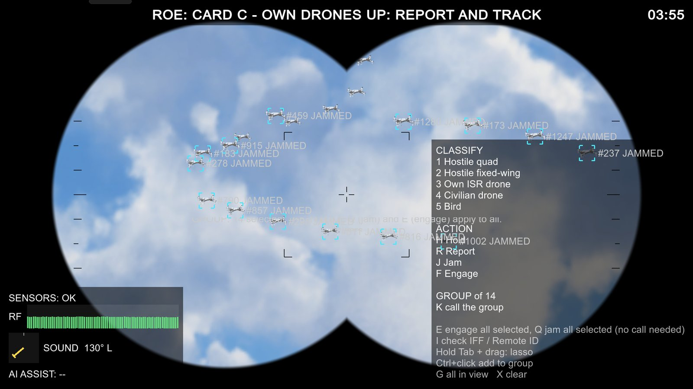

---

## Table of contents

- [Why a simulation engine](#why-a-simulation-engine)
- [Key features](#key-features)
- [Screenshots](#screenshots)
- [How it maps to PS 26247](#how-it-maps-to-ps-26247)
- [Tech stack](#tech-stack)
- [Prerequisites](#prerequisites)
- [Getting started](#getting-started)
- [Running a session](#running-a-session)
- [Controls](#controls)
- [Architecture](#architecture)
- [Scoring: the decision tree](#scoring-the-decision-tree)
- [AI components](#ai-components)
- [Data, files and keys](#data-files-and-keys)
- [Building for Windows and offline use](#building-for-windows-and-offline-use)
- [LAN multiplayer](#lan-multiplayer)
- [Self-tests](#self-tests)
- [Roadmap](#roadmap)
- [Troubleshooting](#troubleshooting)

---

## Why a simulation engine

Drone recognition is not a picture quiz. A quadcopter that is obvious at 200 m against a clear sky is a few pixels at
1.5 km at dusk, behind a ridge, next to a flock of birds and two of your own patrol drones. The two failures that cost
lives are **not seeing it in time** and **engaging the wrong thing**. Fratricide by automation bias and units shooting
down their own drones are both on record.

A clip drill can teach what a drone looks like. Only a simulation can train what happens around it, so that is what
Kurukshetra models:

| What makes the real task hard | How Kurukshetra simulates it |
|---|---|
| Small, distant targets | Detection uses **line of sight against the terrain** and **apparent size on screen** at that range |
| Clutter | Birds and flocks (boids), civilian drones, own ISR drones, swarms of hundreds, **Crowded Sky** with thousands of cooperative drones |
| Deception | **Blend-in hostiles** fly a friendly patrol pattern before breaking off for the post; **IFF / Remote ID** can be silent or spoofed |
| Imperfect sensors | RF, acoustic bearing and an **AI cue** whose reliability the trainer degrades |
| Changing orders | **ROE cards** can change mid-run, so the right action for the same contact changes too |
| Time pressure | Every contact has a **decision clock**; acting after its release point is a miss |
| Light | **Day, dusk and night**, fog, and **night vision** |
| Many operators | **LAN** sentries and a commander, with the report-to-action chain scored |

Every run is **seeded**, so a mission can be replayed exactly and compared across soldiers and units.

---

## Key features

### Two dashboards: trainer and soldier
- **Soldier view:** a first-person post with binoculars (about 7.5x), lock, classify (five classes), Hold / Report / Jam /
  Engage, a sensor panel (RF, sound bearing, AI cue), the ROE banner and a mission clock.
- **Trainer view:** a menu with **TERRAIN, SCENARIO, MAP, EDITOR, BOARD and LOBBY** tabs, and a live **split-screen
  panel (F6)** with a ground-truth map, a map lasso, an event feed, START and the **SCORE** dashboard.

### Terrain: real places, offline, or procedural
- **Real-world terrain download:** pick any place on a map with search and a draggable radius. Kurukshetra fetches
  elevation, drapes a **satellite image** over it, pulls **OpenStreetMap** trees and buildings, and adds a surround
  ring for the horizon. Every step has a timeout, bounded retries, backup servers, a live status line, and Skip / Cancel.
- **Offline:** downloaded areas and map tiles are kept on the PC and bundled next to a Windows build.
- **Procedural, seeded terrain:** real, hybrid or fully procedural heightfields, reproducible from a seed.
- **Vegetation and buildings:** trees chosen by species, altitude and slope (broadleaf, pine, snow and dead trees),
  bushes, grass, OSM building footprints or procedural villages, and an urban or rural site (watchtower, cantonment).
- **Terrain preview** in the menu: relief, satellite and layer overlays before a run starts.

### Mission setup
- **Scenario options:** hostile, own ISR, civilian and bird counts, spawn height and distance ranges, sector, duration,
  difficulty, seed, and a flight pattern per drone type (straight in, orbit the post, zig-zag, pop-up,
  terrain-following, loiter, custom path).
- **Presets** such as Mixed Sky (own drones up, quiet, under attack), Crowded Sky (find the foe), Night Swarm (urban) and
  Day Single Quad (rural).
- **ROE cards A / B / C** with scheduled or random changes, announced by a banner and a tone.
- **2D path editor:** waypoints with height and speed, spawn points and player posts, one-way, loop or ping-pong, for
  single drones, swarms and bird flocks.
- **3D scenario editor:** a free-fly camera to place paths, spawn points, posts, drone and bird groups, and hand-placed
  trees, bushes, buildings and rocks with a brush. It has undo / redo, saves as a scenario package, and test-runs from
  the editor.
- **One-click DEMO:** a fixed 3.5-minute mission on the best terrain available, with a presenter checklist.

### Conditions, sensors and identification
- Day, dusk and night, fog, and **night vision** (N).
- **Degraded sensors** (F3): RF, acoustic bearing and an AI cue whose error rate the trainer sets.
- **IFF / Remote ID challenge** (I): silent friendlies and spoofing hostiles, at rates the trainer sets.
- **Swarms and bird flocks** (boids), and **Crowded Sky**: thousands of cooperative drones at once, with "Crowded Sky"
  and "Extreme" presets.
- **3D lasso** (hold Tab and drag), Ctrl+click, "all in view" and group calls to act on many contacts at once; E
  engages and Q jams the whole selection.
- **Procedural drone sound** with a bearing readout.

### Scoring and after-action review
- **Decision-tree scoring** of every contact: detect, classify, decide and act, on a decision clock, combining process
  ("did you follow the drill for what you could see?") with outcome. **Signal detection** measures (d′ and criterion c)
  for both reporting and engaging. [Details below.](#scoring-the-decision-tree)
- **Score dashboard** with cards ordered weakest problem first, a details view, charts, and filters by player and unit.
- **3D replay** of the logged run with follow, chase, free and top views, truth colours, trails, a seat switcher and
  recorded voice ("clean" or "as heard").
- **Black-box recorder** of view, flags and every decision.
- **HTML report:** one offline file with score cards, charts, the decision tree, a 2D replay, a player / unit filter,
  print to PDF and JSON export. [See an example.](#example-after-action-report)
- **Proficiency board** with pseudonymous IDs and PINs, run on locked reference packages only.

### Learner model and adaptive difficulty
- A **learner model** predicts how likely each soldier is to be right by task, contact class, light and range, across
  sessions, and names the weakest area to practise next.
- **Prevalence settings** (low / medium / high threat rates, including null missions) and **Quiet Watch** for
  vigilance training.
- A **Scenario Director** adapts training runs live. When the soldier is doing well it adds a wave, a decoy or a sensor
  drop; when they struggle it holds back. It cannot be gamed by playing badly, and every change it makes is logged.

### LAN multiplayer
- Host / join by IP on a local network, **SOLO** and **TEAM** modes, terrain transfer to every PC, and a lost-host
  banner.
- **Sentry / commander roles:** sentries search, lock, classify and report; the commander sees every report on a list
  and a map, and is the only one who can jam or engage. The report-to-action chain is scored.
- **Lobby units and roles** (sentry, commander, any, observer), and push-to-talk voice with simulated radio
  degradation (range, noise, dropout).

### VR
- **Simulated VR mode** (F7): the mouse is the head, with hands, a wrist tablet, a radial menu and binoculars held in
  both hands.
- **Real-headset VR** on OpenXR is in progress (see the [roadmap](#roadmap)).

### Settings
- **Graphics:** resolution, window mode, vsync, FPS cap, quality levels (Low / Medium / High / Ultra), render scale,
  shadows, MSAA and view distance, with smooth fades instead of pop-in.
- **Controls:** look and binocular sensitivity, invert Y. **Voice:** microphone, push-to-talk key, level meter.
- Every numeric trainer setting can be typed in, and none has an upper cap.

---

## Screenshots

<table>
<tr>
<td width="50%">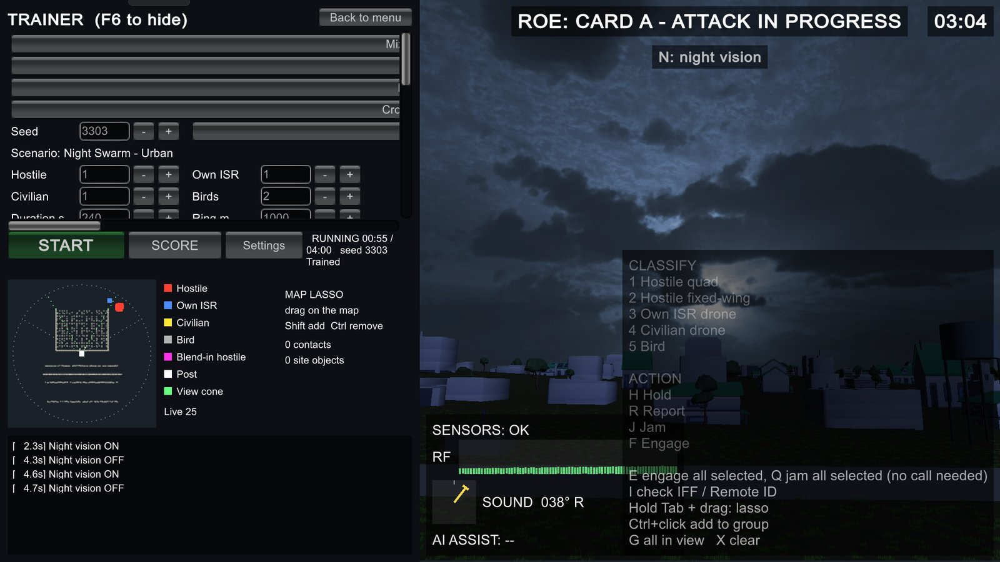<br><sub><b>Trainer and soldier side by side.</b> Night Swarm, urban site, ROE card A. Left: live scenario values, ground-truth map with lasso, event feed. Right: the soldier's view with sensors and action menu.</sub></td>
<td width="50%">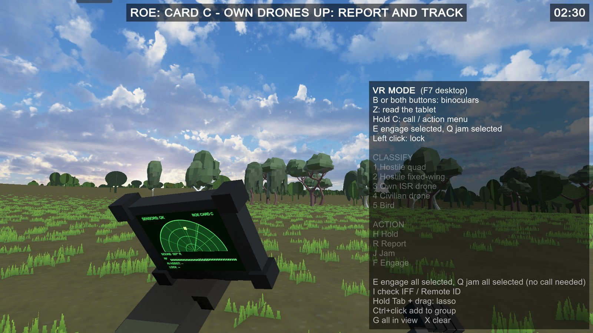<br><sub><b>Simulated VR.</b> Wrist tablet with sensor sweep, sound bearing and ROE card, over procedural terrain with species-aware trees and grass.</sub></td>
</tr>
<tr>
<td width="50%">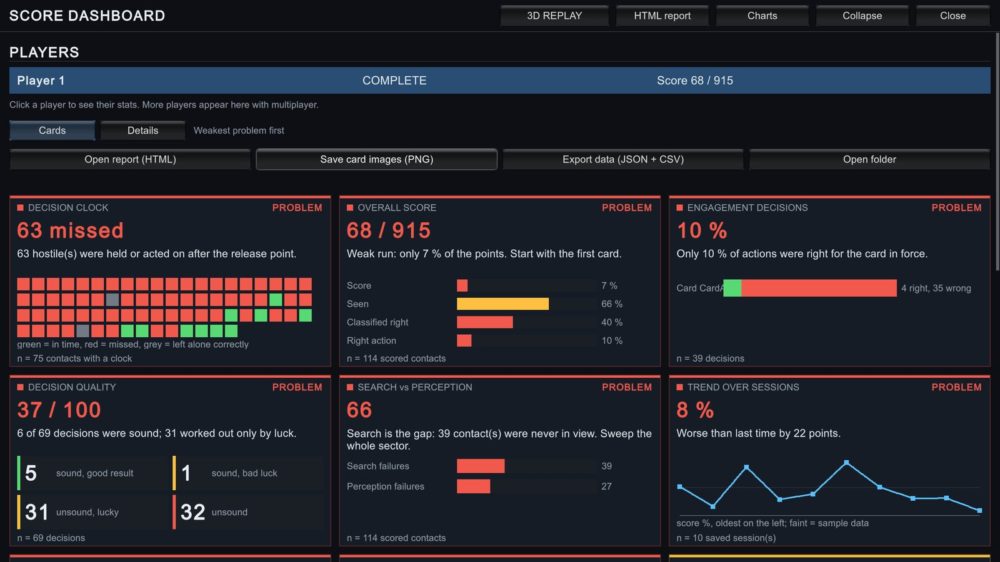<br><sub><b>Score dashboard.</b> Decision clock, overall score, engagement decisions, decision quality, search vs perception, trend over sessions. Weakest problem first.</sub></td>
<td width="50%">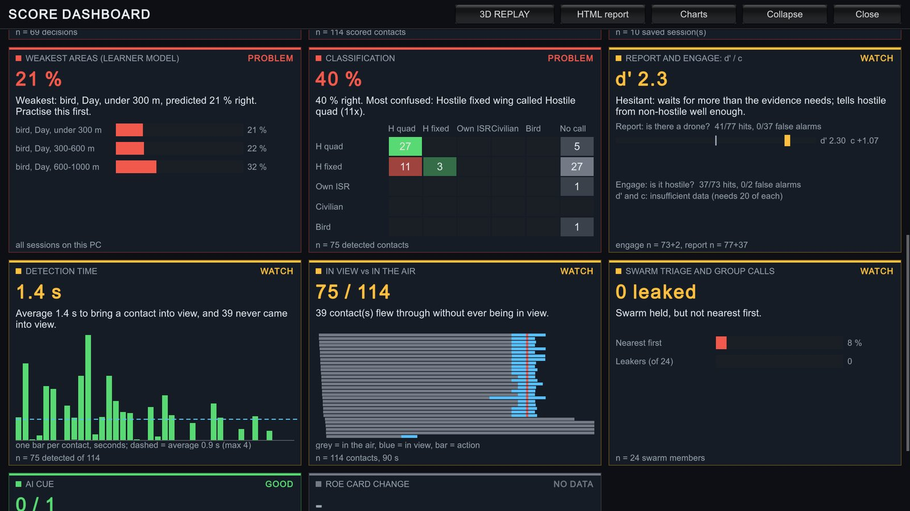<br><sub><b>Learner model and signal detection.</b> Weakest areas by class, light and range, the classification confusion matrix, report and engage d′ / c, detection times and swarm triage.</sub></td>
</tr>
<tr>
<td width="50%">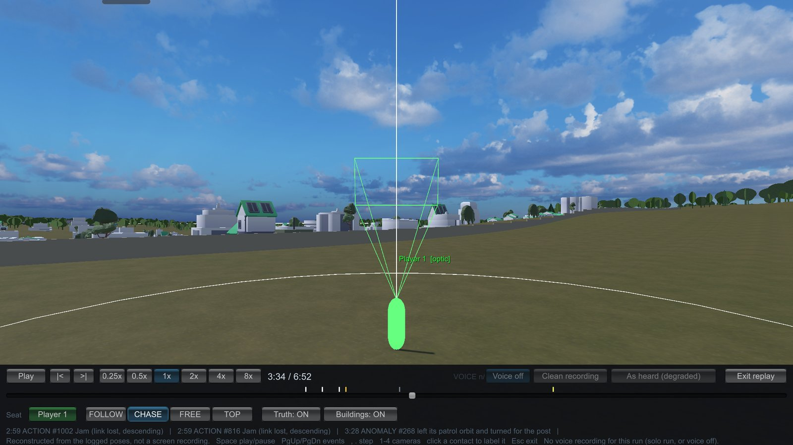<br><sub><b>3D replay.</b> The logged run rebuilt from recorded poses: seat, camera mode, truth and buildings toggles, event markers on the timeline, voice playback.</sub></td>
<td width="50%">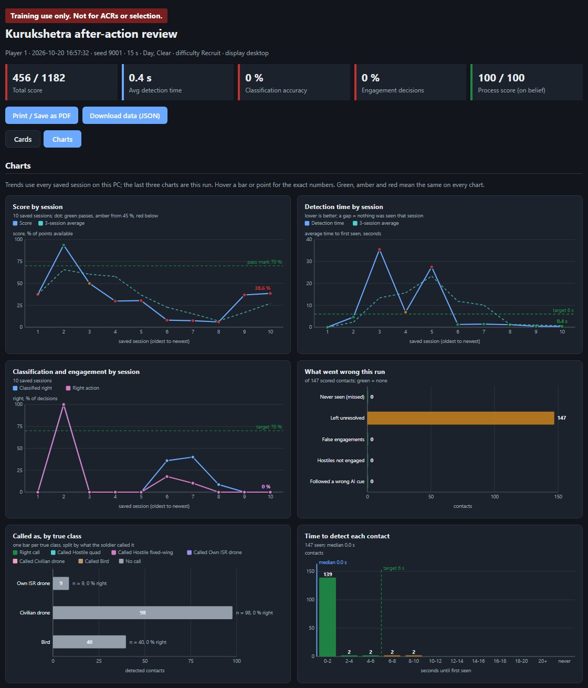<br><sub><b>Offline HTML report.</b> Score, detection and accuracy trends across sessions, what went wrong this run, calls by true class, time to detect.</sub></td>
</tr>
</table>

### Example after-action report

**[Open the example AAR report](https://htmlpreview.github.io/?https://github.com/UtkarshKale/Kurukshetra/blob/main/docs/example-aar-report.html)**
(or download [`docs/example-aar-report.html`](docs/example-aar-report.html) and open it in any browser; it is a single
offline file).

This report was generated by Kurukshetra's own report exporter from a **simulated Crowded Sky session with illustrative
data** (180 s, 21 contacts, ROE card change from C to B at 90 s). It shows what a trainer gets after every run:

- summary tiles and 14 score cards, weakest problem first, plus a Charts tab;
- the **decision tree** drawn like the in-game one, with ALL / previous / next contact stepping and per-contact details;
- the debrief, a timeline of in view vs in the air, and a **2D top-down replay** with play and a time slider;
- the every-contact table and the classification confusion matrix.

The 3D replay lives in the game itself and is not part of the HTML file.

[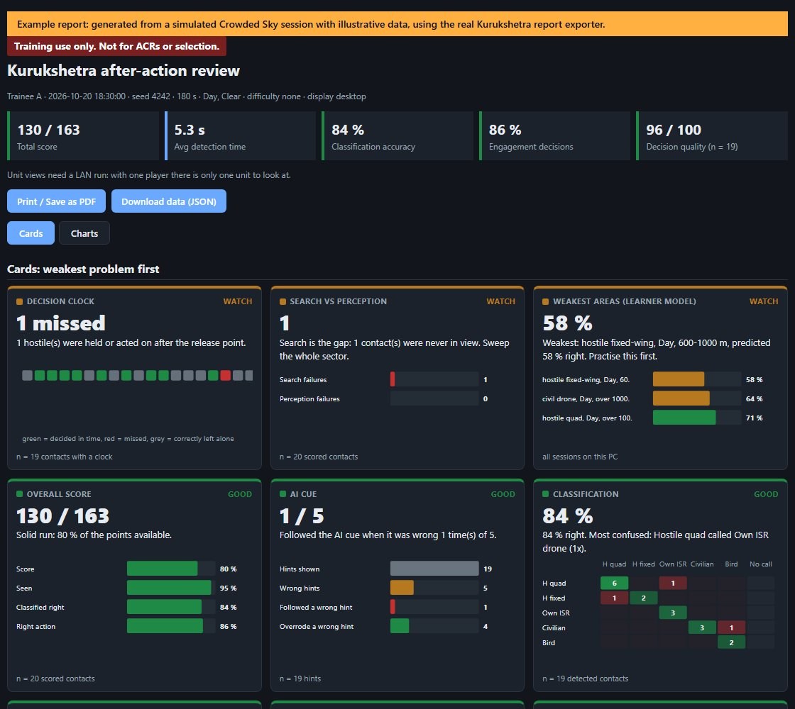](https://htmlpreview.github.io/?https://github.com/UtkarshKale/Kurukshetra/blob/main/docs/example-aar-report.html)

---

## How it maps to PS 26247

| PS requirement | What Kurukshetra does |
|---|---|
| Recognise drone and swarm threats | Sector search with line of sight and apparent size; binoculars; swarms, flocks, Crowded Sky; detection time scored |
| Classify | Five classes (hostile quad, hostile fixed-wing, own ISR, civilian, bird); confusion matrix; IFF / Remote ID challenge |
| Respond | Hold / report / jam / engage under the ROE card in force, on a decision clock; group actions on a lasso selection |
| Day and night | Day, dusk, night, fog, night vision |
| Degraded sensors | RF, acoustic and AI cue degradable by the trainer; IFF silent or spoofed |
| Urban and rural | Urban and rural sites on real or procedural terrain, OSM buildings |
| Single and swarm | From one quad to swarms of hundreds and thousands of cooperative drones |
| Unit level, minimal hardware | Windows desktop, fully offline, LAN for a unit |
| Desktop or VR | Desktop; simulated VR now; real-headset OpenXR in progress |
| Scripted and procedural scenarios | 2D path editor, 3D scenario editor, presets, scenario packages, seeded procedural spawning |
| Decision-tree scoring | Detection time, classification accuracy and the engagement decision, scored per contact (below) |
| AAR, individual and unit, across sessions | Score dashboard, 3D replay, HTML report, unit / player filter, trends, proficiency board |
| Adjustable difficulty, no rote learning | Difficulty levels, prevalence, seeds, mid-run ROE changes, Scenario Director |
| AI-enabled | Learner model, Scenario Director, swarm behaviour, fallible AI cue |

---

## Tech stack

| Layer | Choice |
|---|---|
| Engine | **Unity 6** (6000.6.3f1), Universal Render Pipeline |
| Language | C# (.NET Standard 2.1) |
| Input | Unity Input System |
| UI | Immediate-mode GUI (IMGUI), with one shared chart model drawn in-game and as SVG in the HTML report |
| Networking | Netcode for GameObjects 2.13.3 + Unity Transport 2.6.0 (custom batched snapshots and reliable events) |
| Performance | Burst-compiled jobs for swarms and crowds, GPU instancing for vegetation |
| XR | OpenXR 1.18.0 + XR Interaction Toolkit 3.6.1 |
| Terrain data | Elevation tiles, satellite imagery, OpenStreetMap (Overpass API, with backup servers) |
| Storage | JSON files per session, learner profile, scenario package and report on the local PC |

### System requirements

| | Minimum | Recommended |
|---|---|---|
| OS | Windows 10, 64-bit | Windows 10 / 11, 64-bit |
| CPU | 4-core (Intel Core i3 8th gen / Ryzen 3) | 4-core (Intel Core i5 8th gen / Ryzen 5) |
| RAM | 8 GB | 8 GB |
| GPU | DirectX 11 integrated graphics (Intel UHD 620 / Radeon Vega 8), Low preset, 720p | NVIDIA GTX 1650 (4 GB) or equivalent, High preset, 1080p |
| Storage | 3 GB free | 3 GB free (SSD) |
| Network | None to train; LAN only for team play | Wired LAN or a small router for team play |

Graphics presets (Low / Medium / High / Ultra), render scale and view distance can all be lowered in **F10 > Graphics**.

---

## Prerequisites

- **Windows 10 or 11**, 64-bit.
- **Git** and **Git LFS.** Models, textures, audio and terrain data are stored in LFS.
- **Unity Hub** and **Unity 6000.6.3f1** (install that exact version; use the archive if Hub does not list it).
- About **5 GB** of free disk space for the project and the Unity import cache.
- Internet **once**, for the first package resolve and for any new real-terrain download. Training runs need no
  internet.
- Optional: a microphone for LAN voice, and a second PC on the same network for team play.

---

## Getting started

### 1. Install Git LFS and clone

```bash
git lfs install
```

```bash
git clone https://github.com/UtkarshKale/Kurukshetra.git
```

If LFS was missing during the clone, models arrive as small pointer files. Fix it inside the clone:

```bash
git lfs pull
```

### 2. Open the project in Unity

1. Open **Unity Hub**, then **Projects > Add > Add project from disk**, and pick the `Kurukshetra` folder.
2. Open it with **Unity 6000.6.3f1**.
3. Wait for the first import to finish (the progress bar at the bottom right disappears). Packages resolve
   automatically.

### 3. Run it

1. Open `Assets/Kurukshetra/Scenes/TrainerMenu.unity`.
2. Press **Play**.
3. Press **DEMO** (top right) for a ready-made mission, or set one up yourself (next section).

---

## Running a session

1. **TERRAIN tab:** choose **Procedural** (type a seed) or **Real place** (search the map, set the radius, press
   **Download terrain**). Already downloaded areas work offline.
2. **SCENARIO tab:** pick a preset or set counts, ranges, flight patterns, light, difficulty, ROE card and its changes.
3. **MAP tab** (optional): draw paths, spawn points and player posts in 2D, or open the **3D editor**.
4. Press **START**. The soldier view opens at the post.
5. During the run, the trainer presses **F6** for the split-screen panel: ground-truth map, event feed and live score.
6. At the end, open the **SCORE** dashboard: cards, charts, 3D replay, and **HTML report** to save or print.

For team play, use the **LOBBY** tab first (see [LAN multiplayer](#lan-multiplayer)).

---

## Controls

| Key | Action |
|---|---|
| Mouse | Look |
| Right mouse | Binoculars (zoom) |
| Left click | Lock a contact |
| 1 to 5 | Classify: hostile quad, hostile fixed-wing, own ISR, civilian, bird |
| H / R / J / F | Hold / report / jam / engage the locked contact |
| K | Call a whole group |
| Tab (hold) + drag | 3D lasso |
| Ctrl + click / G / X | Add to selection / select all in view / clear |
| E / Q | Engage / jam everything selected (no call needed) |
| I | IFF / Remote ID challenge |
| N | Night vision |
| F3 | Degrade or restore sensors |
| F6 | Trainer panel |
| F7 | Simulated VR (B binoculars, Z tablet, hold C radial menu) |
| F8 | Presenter checklist (DEMO) |
| F10 | Voice, graphics and controls settings |
| V | Push to talk (LAN, default) |
| Esc | Free the mouse |

---

## Architecture

### Pipeline

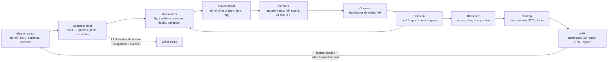

### Directory structure

```
Assets/Kurukshetra/
├── Scenes/
│   ├── TrainerMenu.unity     # trainer dashboard: terrain, scenario, map, editor, board, lobby
│   └── MixedSky.unity        # the field: post, sky, terrain, soldier view
├── Scripts/
│   ├── Scenario/             # contacts, spawner, flight patterns, swarms, birds, Crowded Sky, Director
│   ├── Sensors/              # sensor panel, RF, acoustic, AI cue, IFF, degradation
│   ├── Player/               # observer, binoculars, lock, lasso, decision loop, simulated VR, tablet
│   ├── Environment/          # time of day, night vision, fog
│   ├── Scoring/              # decision tree, signal detection, learner model, prevalence, board, HTML report
│   ├── Replay/               # black-box recorder, 3D replay, voice playback
│   ├── Session/              # run setup and hand-off between menu and field
│   ├── Net/                  # LAN lobby, roles, snapshots, voice, graphics and controls settings
│   ├── Trainer/              # menu, map picker, scenario setup, 2D and 3D editors, dashboard, DEMO
│   └── Audio/                # procedural drone sound
├── Terrain/
│   ├── Scripts/              # heightfield generator, real-data import, OSM layers, trees, bushes, grass, buildings
│   ├── Configs/              # terrain generator configs
│   └── RealData/             # bundled real-terrain areas (elevation, satellite, OSM)
├── Data/                     # contact definitions, difficulty levels, presets, scoring rules, sensor and site profiles
├── Prefabs/  Materials/  Settings/  Resources/
└── Docs/DEMO-SCRIPT.md       # the 5-minute demo walkthrough
```

### Key systems

- **Contacts and motion.** Each contact has a class, a flight pattern and a schedule from the seeded scenario. Swarms
  and flocks are boids; large swarms and Crowded Sky run as Burst jobs.
- **Detection.** A contact counts as "in view" only with line of sight past the terrain and enough pixels on screen at
  that range and zoom, so detection is scored on what the screen actually showed.
- **Decision loop.** Lock, classify, act; or act on a lasso selection. Every action is checked against the ROE card in
  force at that moment.
- **Black box.** Poses, view direction, flags and every decision are written during the run. The 3D replay and every
  score are rebuilt from this log, not from a screen recording.
- **Trainer and soldier split.** The same scene drives both views; the trainer panel adds ground truth that the soldier
  never sees.
- **Networking.** The host is authoritative. It sends one batched snapshot of all contacts per tick plus reliable
  events (reports, decisions, card changes). Big swarms are streamed compactly.

---

## Scoring: the decision tree

Every contact goes through the same checkpoints. Each is scored on its own, so the AAR says exactly where the chain
broke.

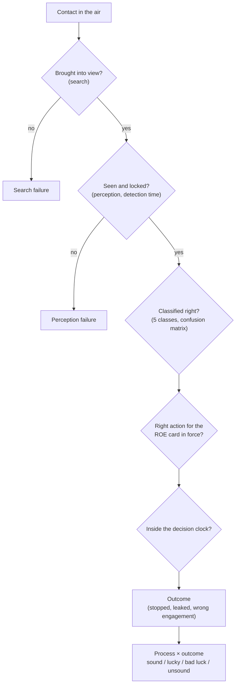

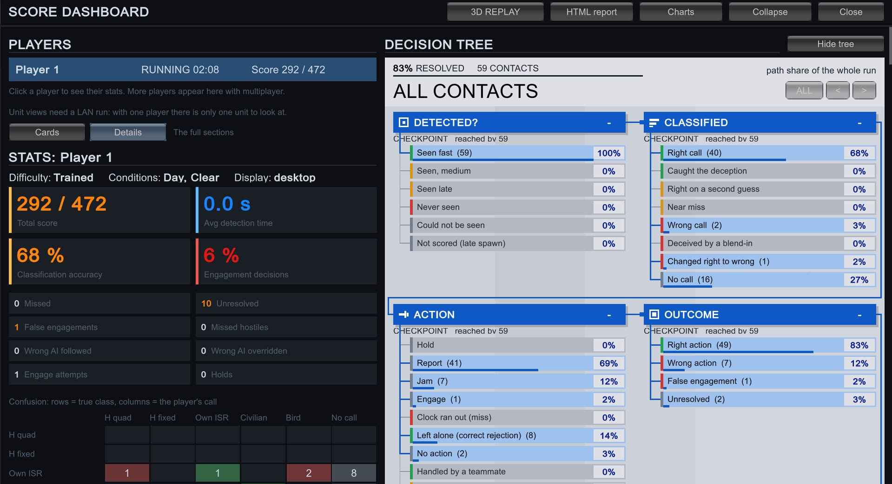

- **Detection time:** seconds from entering view to lock.
- **Classification accuracy** with a full confusion matrix.
- **Engagement decision** against the card in force, including after a mid-run card change.
- **Decision clock:** holding a hostile past its release point is a miss.
- **Decision quality** (process): did the soldier follow the drill for what they could see, regardless of luck? A hostile
  that came into view and was never acted on counts as 0.
- **Signal detection:** d′ and criterion c for reporting ("is there a drone?") and engaging ("is it hostile?"), shown
  only with enough trials.
- **Swarm triage:** nearest-first order and leakers.
- **AI cue:** followed or overrode a wrong hint.
- **Team chain:** sentry report to commander action, in TEAM mode.

---

## AI components

| Component | What it does |
|---|---|
| **Learner model** | Logistic model of P(correct) by task, contact class, light and range, pooled across sessions. Names the weakest area and the next thing to practise. |
| **Scenario Director** | Training runs only. Reads the ground-truth threat state and recent accuracy (never input rate), adds waves, decoys or sensor drops when the soldier is coping, and holds back when they are not. Downward moves are capped and implausibly fast wrong calls are flagged, so it cannot be gamed. Every change is logged. |
| **Swarm and flock behaviour** | Boids, formations and patrol patterns, with blend-in hostiles that break off a friendly pattern. |
| **AI cue** | A fallible label with a trainer-set error rate, seeded per contact so every PC sees the same cue. It trains trust calibration: the score shows whether the soldier followed or overrode a wrong hint. |

---

## Data, files and keys

| What | Where |
|---|---|
| Sessions, learner profile, scenario packages, range data, HTML reports | Unity's persistent data folder: `%USERPROFILE%\AppData\LocalLow\<company>\<product>\` |
| Map tile cache and downloaded areas (outside the Editor) | the same folder, `RealData\` and the tile cache |
| Bundled areas inside the project | `Assets/Kurukshetra/Terrain/RealData/` |
| Optional map keys | `%USERPROFILE%\.kurukshetra\carto.key`, `%USERPROFILE%\.kurukshetra\arcgis.key` |

### Optional environment variables

| Variable | Purpose | Required |
|---|---|---|
| `CARTO_API_KEY` | Place-name labels on the map picker (CARTO) | No |
| `ARCGIS_API_KEY` | ArcGIS satellite imagery | No |

Keys are read at run time from the environment or the `.kurukshetra` folder. They are **never stored in the project,
never cached on disk and never copied into a build**. Everything else works without them.

---

## Building for Windows and offline use

1. In Unity: **File > Build Profiles > Windows**. The scene list already holds `TrainerMenu` and `MixedSky`.
2. Press **Build** and choose an empty folder.
3. After the build, Kurukshetra copies the cached map tiles and every downloaded real-terrain area into
   `<build folder>/KurukshetraData/`, so the build runs on another PC with no internet.
4. Copy the **whole build folder** to the training PC.

Editor tools under the **Kurukshetra** menu:

| Menu item | What it does |
|---|---|
| Kurukshetra > Terrain Generator | Build terrain from real data, seeded noise, or both |
| Kurukshetra > Terrain > Fetch OSM layers for downloaded areas | Fetch trees and buildings for areas that have none |
| Kurukshetra > Offline map > Prefetch map tiles around downloaded areas | Fill the tile cache before going offline |
| Kurukshetra > Terrain > Wire real art into kit | Assign the vegetation art to the terrain layer kit |
| Kurukshetra > VR > Set up OpenXR | Configure the OpenXR loader for a headset |

---

## LAN multiplayer

1. Put every PC on the **same network** (a small router or a phone hotspot; venue Wi-Fi often isolates clients).
2. Use **the same build on every PC.**
3. Allow the game through Windows Firewall on **private networks** (UDP port **7777**).
4. Trainer PC: **LOBBY > Host**, choose **TEAM**, add units, and assign roles (sentry, commander, any, observer).
5. Each trainee PC: type the host's IP (shown on the host), **Join**, then **I'm READY**.
6. The trainer presses **START**. Every PC gets the same terrain and the same sky.
7. After the run, the dashboard shows every seat, with a filter by unit and player.

---

## Self-tests

Kurukshetra ships 28 self-test suites that run inside the Editor, covering scoring, sensors, swarms, crowds, birds,
lasso, learner model, prevalence, terrain generation, layers, vegetation, offline maps, packages, reports, the
dashboard, replay, networking, team roles, voice, sound, site, range and VR:

```
Assets/Kurukshetra/Scripts/**/*SelfTest.cs   Assets/Kurukshetra/Terrain/Scripts/LayersSelfTest.cs
```

Each exposes a static `Run()` that returns pass / fail and logs every check to the Console.

---

## Roadmap

| Planned | What it adds |
|---|---|
| **Real-headset VR** | Vendor-neutral OpenXR + XR Interaction Toolkit for PC VR headsets. Packages and scripts are in; headset testing is next. |
| **Offline AI scenario builder** | Describe a mission in plain words; a local language model (no cloud) turns it into a validated scenario. |
| **Sensor suite** | Continuous-zoom EO sight with mil reticle, laser rangefinder, thermal sight, RF spectrum waterfall, radar. |
| **Positive identification rule** | Each ROE card states how many independent sensors must agree before engaging. |
| **Track table** | Evidence chips per contact and a PID counter. |
| **Richer black box** | 10 Hz operator state, every zoom and trigger pull, raw telemetry export. |
| **More terrain and tactics** | Coastal site, formation shadowing, gliders. |
| **Field validation** | Two-PC team runs, a cable-pulled offline run, and a pilot study against an equal-time clip drill. |

---

## Troubleshooting

**Models or textures are missing or grey after cloning.**
Git LFS was not installed when you cloned. Run `git lfs install` and then `git lfs pull` in the project folder.

**Pink terrain or objects in a build.**
Make a fresh build with the Windows build profile. Runtime-created objects take their shaders from
`Assets/Kurukshetra/Resources/Kurukshetra/`; do not delete that folder.

**A terrain download stops at "Map features (OpenStreetMap)".**
The OSM servers can be slow. Wait for the next try, or press **Skip this step**: the area still completes, and
**Fetch map features** fetches trees and buildings later.

**Map labels are missing.**
Labels need the optional CARTO key; see [Data, files and keys](#data-files-and-keys).

**A trainee PC cannot join.**
Check that both PCs are on the same network, run the same build, and allow UDP 7777 on private networks.

**The game looks frozen in the Editor.**
Click inside the Game view; an unfocused Editor pauses the game.
